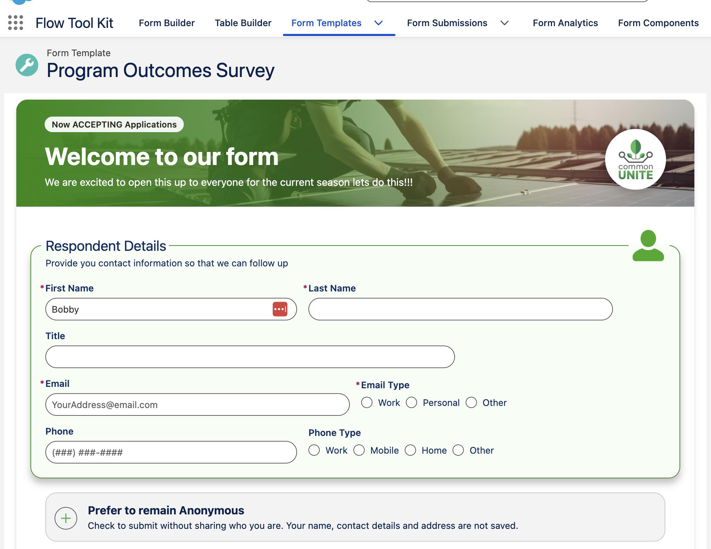

# Banner Sections

A Banner section gives a form a branded title: a photo, your logo, a title, a subtitle and a few tags. Add it from **Add Section** in the Form Builder, next to Field Set, Image and Record Card. It is most often placed in the Form Template header, where it becomes the top of the form.

Walkthrough: building a banner in the Form Builder (tags, title, photo, layouts), then the banner heading a live form from the template header.



## Layouts

| Layout | What it draws | Use it for |
|---|---|---|
| Overlay | The photo across the banner, the text on a side scrim, the logo floating at the right | Multi-page forms with the vertical page indicator, and stages mode. Keep it at Small |
| Split | The text on a color panel beside the photo, the logo on the seam | Very simple titles |
| Compact | A short photo strip with the logo on its edge, the text below on the form's background | Single-page forms, where it blends in as the form's title |

## Height

**Small** (the default) follows its text, so a banner without tags or a subtitle is slimmer. **Medium** and **Large** hold a taller banner for a form that features its photo. Overlay and Split are the same height at each size.

## Settings

| Setting | What it does |
|---|---|
| Tags | Pills above the title. Separate them with semicolons ("2027 season; About 10 minutes"), or use a multi-select picklist merge field |
| Title and Subtitle | Rich text, so you can bold, color or link words. Merge fields work in both |
| Tag Color | The pill color. Text turns white on a dark color. Leave it empty to follow the brand |
| Background Image | Picked from your images. A field override lets a field on the record set the photo, including a rich text field holding an image |
| Background Color | Fills the Split panel, and shows when there is no photo |
| Scrim Color | The shade behind the text on the photo, with an opacity |
| Logo, Logo Shape and Alt Text | Your logo on a white Square or Circle card, or None to show the logo on its own |

## The default template header

A Form Template's header and footer are ordinary Form Components built on the Form Template object, so they show the template's own fields through merge fields. A field with a value shows; an empty one does not. One header built this way serves every template.

Every new Form Template starts with the packaged header **Form Header Banner (Template)**, one Overlay banner whose settings are the template's fields:

| Banner setting | Merge field | Where you set it on the template |
|---|---|---|
| Title | `{{Name}}` | Form Setup, Form Template Title |
| Subtitle | `{{FlowToolKit__Form_Template_Subtitle__c}}` | Form Setup, Form Template Subtitle |
| Tags | `{{FlowToolKit__Header_Tags__c}}` | Form Setup, **Header Tags**: short tags separated by semicolons, such as "2027 season; About 10 minutes" |
| Image Override Field | `{{FlowToolKit__Form_Banner_Image__c}}` | Form Images, Banner/Header Image |

A template with only a name shows its name on a band of your brand color. Each field you fill adds its part, and a change shows on the next load with no header edit. To use another layout or add your logo, clone the header in the Form Builder and pick the clone on the template's **Header/Footer** tab.

Header Tags works anywhere a merge field does: in a Banner's Tags setting it draws one pill per tag; in rich text it shows the text as typed, semicolons included.

Walkthrough: a new template opening on the Banner header, with its subtitle, Header Tags and photo set on the template.



**Templates made before this release keep the header they have.** Earlier versions gave new templates the rich text header **Form Header (Template)** (`Form_Header_Demo`). It is no longer in the package: upgraded orgs keep it, marked deprecated, and templates that use it keep working. To move a template to the Banner header, pick **Form Header Banner (Template)** on its Header/Footer tab. Once no template uses the old header, an admin can delete it from Setup, Custom Metadata Types, Form, Manage Records.

## Spacing

On the section's **Style** tab, **Padding Top**, **Padding Bottom** and **Padding Horizontal** add space inside the banner, around its text. **Margin** settings move the whole banner.

In a single-card Form Template (no vertical page indicator), a header banner has square bottom corners so it joins the form below it.

## Good to know

- Guests see a photo from a rich text field only when the record is shared with the site's guest user. Otherwise they see the picked image.
- The banner does not show on the confirmation screen.
