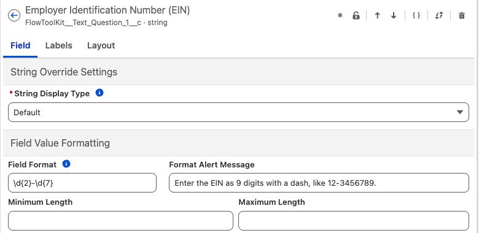
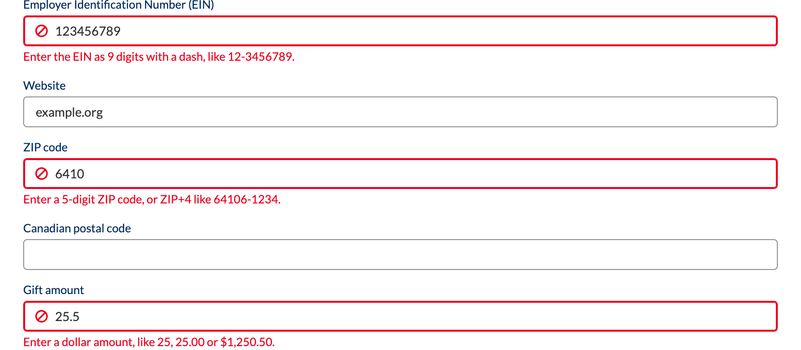

# Field Format Patterns

> Make a field accept only the shape of value you need, such as a ZIP code, an EIN or a dollar amount, and tell the person exactly how to fix it when they miss. Copy a tested pattern from the library below, or write your own.

## Video Walkthrough

<!-- Walkthrough: Vimeo embed goes here once the release copy is published. -->

## How it works

Every Text, Email, Phone, URL and Encrypted field in Form Builder has two settings under **Field Value Formatting** on the field's **Field** tab:

* **Field Format**: the pattern the value must match, written as a regular expression.
* **Format Alert Message**: the sentence shown under the field when the value does not match. Write it as the fix: "Enter the EIN as 9 digits with a dash, like 12-3456789."



What the person sees:

1. **When they leave the field**, a value that does not match turns the field red and shows your Format Alert Message under it.
2. **When they click Continue, Next or Submit**, the form checks every field on the page again. A value that does not match keeps them on the page and shows an error for that field.
3. **An empty field is not checked.** The pattern only checks a field that has a value. Use **Required** to make the field required.



Rules the pattern follows:

* **The whole value must match.** `\d{5}` accepts `64106` and blocks `641061`. You do not need `^` at the start or `$` at the end, though adding them does no harm.
* **Patterns use JavaScript's Unicode rules (the `v` flag),** the same rules the browser applies to an input's `pattern`. Some characters must be escaped inside square brackets. See [Patterns that break](#patterns-that-break).
* **Lengths:** the Field Format holds up to 255 characters. Form Builder limits the Format Alert Message to 80 characters.


**Version 5.4 and later.** From 5.4, the form's own check before moving on reads the pattern with exactly the browser's rules (the whole value, with Unicode). Before 5.4 that check ignored Unicode classes such as `\p{L}`, so a pattern using them blocked every value. On an earlier version, use the plain A to Z patterns below.


## Supported field types

| Field type | Field Format available | What happens |
| --- | --- | --- |
| Text | Yes | The value as typed is checked. |
| Email | Yes | Your pattern and message replace the [built-in email check](field-validation.md#built-in-email-address-check). |
| Phone | Yes | Phone masking runs first, so the pattern checks the masked value. See [Phone fields and masking](#phone-fields-and-masking). |
| URL | Yes | Shown as a plain text box, so only your pattern checks the shape of the address. |
| Encrypted (Text) | Yes | Shown through Salesforce's standard field, so no message appears under the field. The check runs when the person clicks Continue or Submit, and the error names the field. |
| Every other type | No | Form Builder does not show the setting. |

### Email fields and the built-in check

Every Email field already checks for a full address, like `name@example.com`, without any setup. A Field Format on an Email field replaces that check: the form uses only your pattern and your Format Alert Message. Two tested email patterns, **Standard (matches Salesforce)** and **Public addresses only**, are in [Ready-made email patterns](field-validation.md#ready-made-email-patterns).

The built-in check only looks at an address the person typed or changed on this visit, so a prefilled address is never blocked. Your own Field Format applies to whatever value the field holds, prefilled values included.

### Phone fields and masking

A Phone field formats the number as the person types: with the standard mask, `8165550134` becomes `(816) 555-0134`. The mask runs **before** the pattern, so:

* **With a mask on**, write the pattern for the masked shape. The mask already requires 10 digits. The **US phone with the standard mask** pattern below also requires a real area code and exchange.
* **To accept any common way of writing a US number** (`816-555-0134`, `816.555.0134`, `+1 816 555 0134`), set **Phone Mask** to **none** and use the [Phone (US) pattern](field-validation.md#ready-made-text-field-patterns).
* A pattern written for digits only, such as `\d{10}`, never matches a masked value, so it blocks every number.
* With the US mask, a person who types the country code shifts every digit: `+1 816 555 0134` becomes `(181) 655-5013`. The masked pattern below blocks that number, because no US area code starts with 1.

## Pattern library

Every pattern below was tested three ways: in Node the way the browser runs it, as the Field Format on a real Form Template, and as the logged-out guest on an Aura site and an LWR site. On both sites, every bad sample showed the Format Alert Message and kept the guest on the page, and every good sample went through.

Paste the pattern into **Field Format** exactly as shown (one backslash, not two), and the message into **Format Alert Message**.

| Pattern | Field type | Use this when | Samples tested (good / bad) |
| --- | --- | --- | --- |
| [Email, Standard](field-validation.md#ready-made-email-patterns) | Email, Text | You want every address Salesforce will save, with your own message | 5 / 6 |
| [Email, Public addresses only](field-validation.md#ready-made-email-patterns) | Email, Text | You want ordinary internet addresses only | 5 / 6 |
| [Phone (US), any format](field-validation.md#ready-made-text-field-patterns) | Text, Phone with mask none | People write numbers in different ways | 6 / 6 |
| [US phone with the standard mask](#us-phone-with-the-standard-mask) | Phone | You keep the mask and want a real area code | 3 / 3 |
| [ZIP code (US)](field-validation.md#ready-made-text-field-patterns) | Text | A US postal code, 5 digits or ZIP+4 | 5 / 6 |
| [EIN](#ein-employer-identification-number) | Text | An organization's federal tax ID | 3 / 5 |
| [Last 4 digits of SSN](#last-4-digits-of-ssn) | Text, Encrypted | You verify identity without collecting the full number | 3 / 5 |
| [Dollar amount](#dollar-amount) | Text | An amount kept as text, cents optional | 6 / 6 |
| [Whole dollars](#whole-dollars) | Text | Pledges or budgets in whole dollars | 5 / 5 |
| [Name, letters only](#name-letters-only) | Text | Names in any language | 7 / 6 |
| [Name, A to Z only](#name-a-to-z-only) | Text | A system downstream accepts only plain letters | 5 / 5 |
| [Canadian postal code](#canadian-postal-code) | Text | Canadian addresses | 4 / 5 |
| [4-digit year](#4-digit-year) | Text | A year such as founding year or first gift | 4 / 5 |
| [Website address](#website-address) | URL, Text | An organization's website | 5 / 6 |

The email, Phone (US) and ZIP code patterns are documented with their samples in [Field Validation](field-validation.md#ready-made-email-patterns) and were tested again here with the same text.

### US phone with the standard mask

```
\([2-9]\d{2}\) [2-9]\d{2}-\d{4}
```

* **Format Alert Message**: "Enter a 10-digit US phone number with a real area code."
* **Use this when** the field keeps the standard `(xxx) xxx-xxxx` mask. **Accepts** what the mask makes of `8165550134`, `212 555 0199` and `303.555.0101`. **Blocks** `+1 816 555 0134` (masked to `(181) 655-5013`), `0165550134` and `8161550134`.

### EIN (Employer Identification Number)

```
\d{2}-\d{7}
```

* **Format Alert Message**: "Enter the EIN as 9 digits with a dash, like 12-3456789."
* **Use this when** you collect an organization's federal tax ID on a grant application or vendor form. **Accepts** `12-3456789`. **Blocks** `123456789`, `123-456789`, `12-345678` and `AB-1234567`. To also accept the 9 digits without the dash, use `\d{2}-?\d{7}`.

### Last 4 digits of SSN

```
\d{4}
```

* **Format Alert Message**: "Enter only the last 4 digits of the Social Security number."
* **Use this when** you match a person to a record without storing the full number. **Accepts** `1234` and `0042`. **Blocks** `123`, `12345` and a full `123-45-6789`. Never collect a full Social Security number in a plain Text field.

### Dollar amount

```
\$?(?:\d{1,3}(?:,\d{3})*|\d+)(?:\.\d{2})?
```

* **Format Alert Message**: "Enter a dollar amount, like 25, 25.00 or $1,250.50."
* **Use this when** an amount is kept in a Text field, for example an "other amount" box. **Accepts** `25`, `25.00`, `$25`, `$1,250.50`, `1250.50` and `1000000`. **Blocks** `25.5`, `$25.505`, `1,25`, `$-25` and `25 dollars`. For a Currency field, use **Minimum** and **Maximum** instead.

### Whole dollars

```
\$?(?:\d{1,3}(?:,\d{3})*|\d+)
```

* **Format Alert Message**: "Enter a whole dollar amount with no cents, like 100 or $1,000."
* **Use this when** you ask for a pledge or a budget line in whole dollars. **Accepts** `100`, `$100`, `1,000` and `$25,000`. **Blocks** `100.00`, `$100.50`, `1,00` and `-100`.

### Name, letters only

```
[\p{L}\p{M}]+(?:[ '’\-][\p{L}\p{M}]+)*
```

* **Format Alert Message**: "Use letters only. Spaces, hyphens and apostrophes are fine."
* **Use this when** you want to keep digits and symbols out of a name but welcome every language. **Accepts** `Maria`, `José`, `Mary-Kate`, `O'Brien`, `O’Brien`, `De la Cruz` and `Nguyễn`. **Blocks** `R2D2`, `Ann!`, `J.`, a leading or trailing hyphen, and a double space. Needs version 5.4 or later.

### Name, A to Z only

```
[A-Za-z]+(?:[ '’\-][A-Za-z]+)*
```

* **Format Alert Message**: "Use the letters A to Z only. Spaces, hyphens and apostrophes are fine."
* **Use this when** the value goes to a system that accepts only plain letters, such as a bank file, or on a version before 5.4. **Accepts** `Maria`, `Mary-Kate`, `O'Brien` and `De la Cruz`. **Blocks** `José`, `R2D2` and `Ann!`.

### Canadian postal code

```
[ABCEGHJ-NPRSTVXYabceghj-nprstvxy]\d[ABCEGHJ-NPRSTV-Zabceghj-nprstv-z] ?\d[ABCEGHJ-NPRSTV-Zabceghj-nprstv-z]\d
```

* **Format Alert Message**: "Enter a Canadian postal code, like K1A 0B1."
* **Use this when** you collect Canadian addresses. Uses only the letters Canada Post issues. **Accepts** `K1A 0B1`, `K1A0B1` and `m5v 3l9`. **Blocks** `D1A 0B1`, `K1A 0B`, `K1A-0B1` and a US ZIP code.

### 4-digit year

```
(?:19|20)\d{2}
```

* **Format Alert Message**: "Enter a 4-digit year, like 2026."
* **Use this when** you ask for a year, such as the year an organization was founded or a first gift. **Accepts** `1900` to `2099`. **Blocks** `26`, `1899`, `2100` and `'26`.

### Website address

```
(?:https?:\/\/)?(?:[A-Za-z0-9](?:[A-Za-z0-9\-]*[A-Za-z0-9])?\.)+[A-Za-z]{2,}(?:[\/?#]\S*)?
```

* **Format Alert Message**: "Enter a website address, like example.org or https://example.org/donate."
* **Use this when** you collect an organization's website. A URL field otherwise accepts any text. **Accepts** `example.org`, `www.example.org`, `https://example.org/donate?fund=1` and `http://sub.example.co.uk/path#top`. **Blocks** `example`, `https://`, `ftp://example.org`, `https://example` and an address with a space.

## Patterns that break


**A hyphen in the wrong form breaks the whole pattern.** The browser's `v` flag rejects a pattern such as `[A-Za-z -]+` (a bare hyphen inside square brackets) or `\d{5}\-\d{4}` (an escaped hyphen outside them).

**What you see today:** Form Builder saves the pattern. On the form, no message appears under the field, whatever is typed. When the person clicks Continue or Submit, the form stops them with a "Format Error" toast that names the field but not the fix. A fix is coming: Form Builder will check the pattern when you save it and say "This pattern is invalid".

**How to write it:**

* Inside square brackets, escape the hyphen: `[A-Za-z \-]+`. Putting the hyphen first or last in the brackets does not work under the `v` flag.
* Outside square brackets, leave the hyphen alone: `\d{5}-\d{4}`.
* Test it in Form Builder's **Form Preview**: type a value that should fail and click away. No message means the pattern is broken.


## Gotchas

**Escape special characters correctly.** Inside square brackets, also escape `( ) [ ] { } / | \`, and never put the same punctuation mark twice in a row (`&&`, `!!`). Outside brackets, escape only characters that mean something in a pattern: `\ ^ $ . | ? * + ( ) [ ] { } /`.

**Type one backslash.** A pattern copied from code or JSON often shows `\\d`. In Field Format, `\\d{5}` means a backslash followed by five letter d's, so it blocks every value. Type `\d{5}`.

**There is no case-insensitive switch.** List both cases: `[A-Za-z]`, or both letters in a list as the Canadian postal code does.

**Spaces count.** A leading or trailing space, often pasted in, makes the value fail. The message tells the person what shape to use, so say "like 64106" rather than "invalid ZIP".

**Allow both apostrophes.** Phones and Macs often type a curly apostrophe (`’`) instead of a straight one (`'`). The name patterns above accept both.

**Test the pattern before you publish.** In Form Builder's **Form Preview**, type a value that should fail and click away. If no message appears, the pattern is broken (see [Patterns that break](#patterns-that-break)) or does not match what you expect.

**Set it where the section's form lives.** A Form Template section either points at a Form Component or holds its own copy of a form configuration. When the section holds its own copy, the guest form uses that copy, and a Field Format set on the Form Component does not reach the page. Edit the format through the section's own form, or point the section at the Form Component.

**Changing a field's type can clear the pattern.** When **Change Field** moves a field to a type that does not support Field Format, the Field Format and Format Alert Message are cleared.

## Related Pages

* [Field Validation](field-validation.md): required fields, lengths, number and date limits, the built-in email check
* [Field Type Settings](field-type-settings.md): phone masking and other per-type settings
* [Input Field Configuration](input-field-configuration.md): field configuration overview
