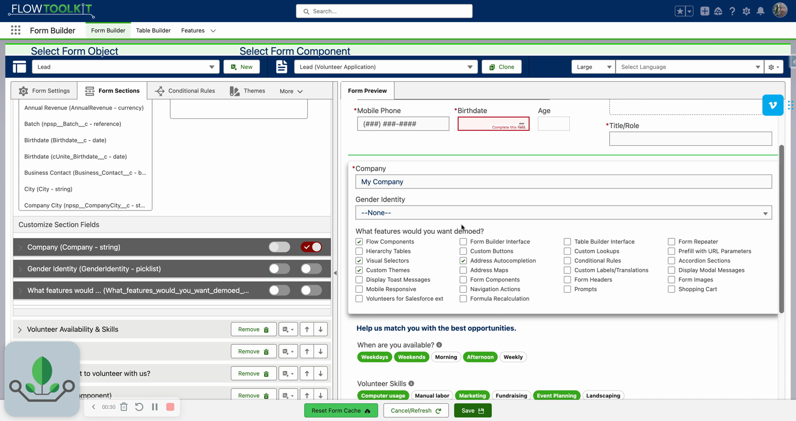
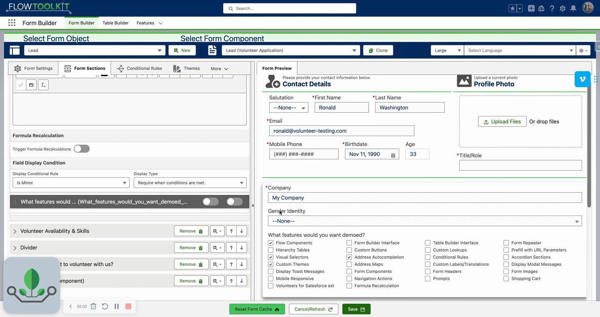
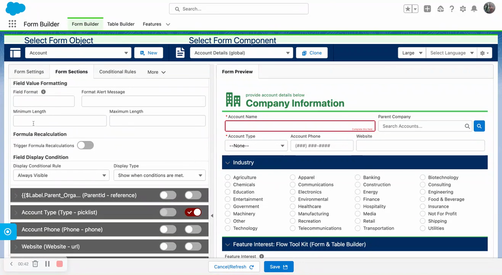
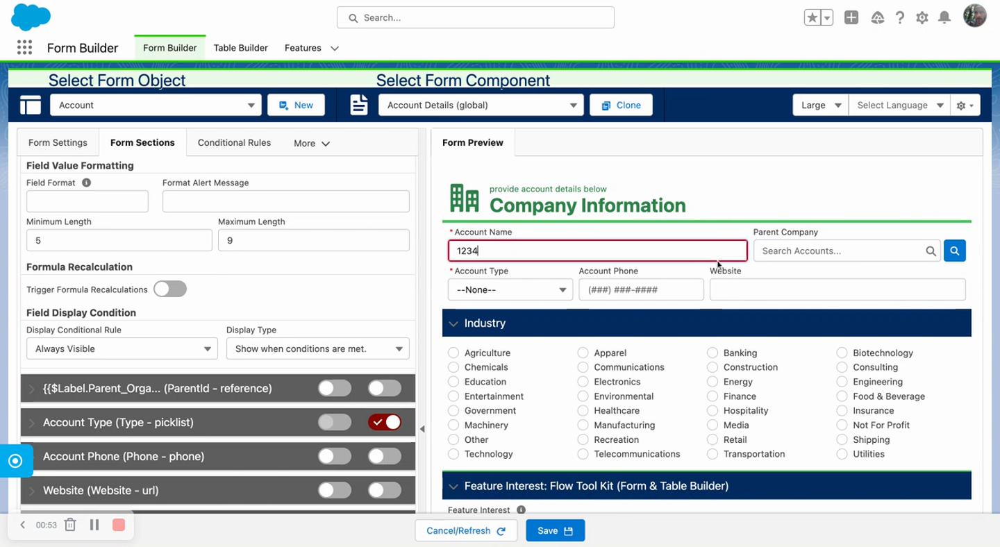
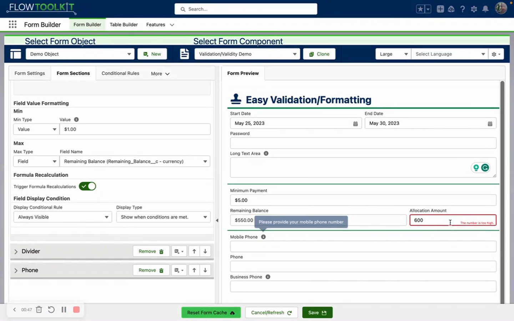
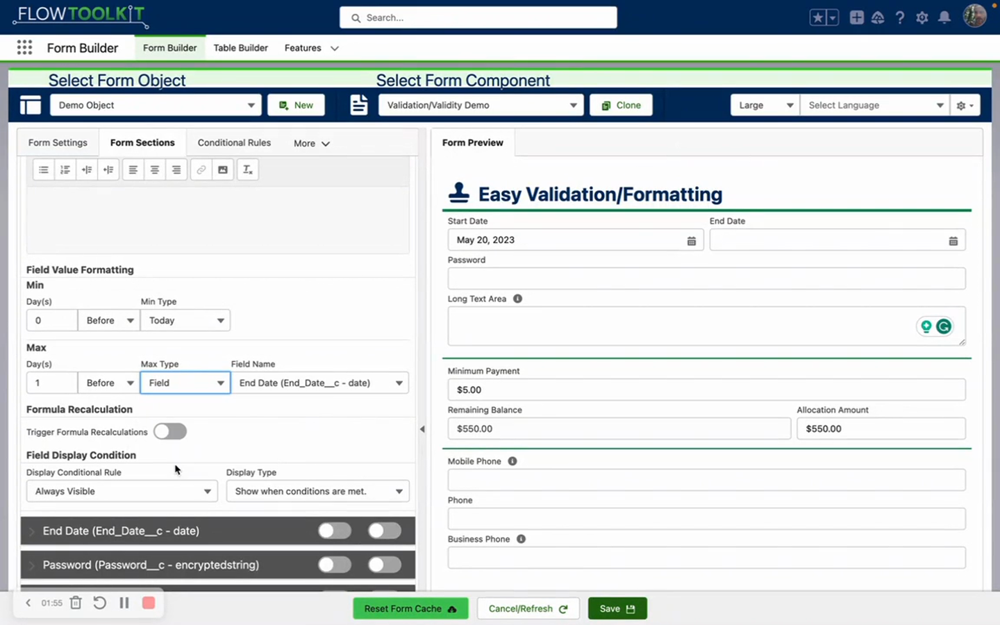
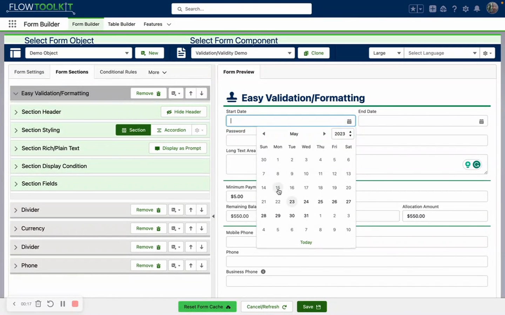
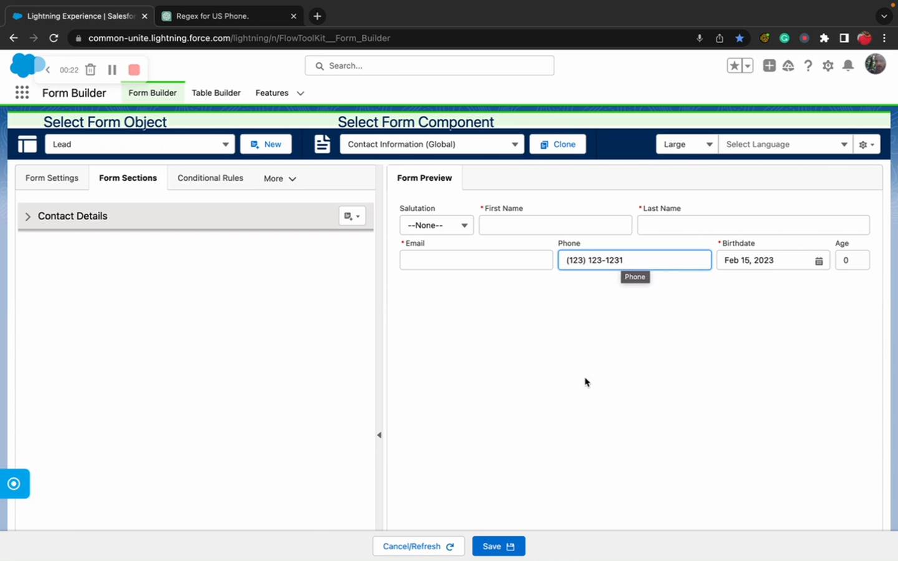

# Field Validation

Survey Mode keeps required-field validation when advancing a question or row. See the recorded [required-name-row example](../form-template-framework/survey-mode.md#required-answers-and-returning-to-a-question): an empty row blocks **Next**, and completing both names allows it to advance.

> Enforce required fields, read-only states, minimum/maximum values, and regex patterns, manually or dynamically through conditional rules.

## Video Walkthroughs





## Overview

Flow Tool Kit provides field-level validation that goes beyond standard Salesforce validation rules. Set fields as required or read-only, define min/max constraints for text length, number values, and date ranges, and apply regex patterns, all configured in Form Builder with real-time client-side enforcement.

## Required & Read-Only Fields

### Manual Toggles

Each field has **Required** and **Read Only** toggles in its customization panel:

* **Required**: Prevents form submission until the field has a value. Shows a validation error if left blank.
* **Read Only**: Displays the field value but prevents editing. Useful for showing calculated or prefilled data.




**System-required fields** (fields marked required at the object schema level, e.g., Company on Lead) **cannot** be made optional. The required toggle is locked.


### Conditional Required / Disabled

Fields can be dynamically required or disabled based on conditional rules:

1. Open a field's customization panel.
2. Navigate to **Display Conditional Rules**.
3. Select a conditional rule (e.g., "Is Minor").
4. Choose the action: **Require** or **Disable** (in addition to the standard Hide/Show).

**Example**: A Date of Birth field triggers an "Is Minor" rule. When the date indicates a minor, the Guardian Name field becomes required automatically.



### Read-Only Behavior

* Multi-select picklist fields displayed as read-only show **only the selected values** (not the full option list), useful for displaying completed form results.
* Conditional rules can combine with manual settings: a field can be normally optional but become required based on another field's value.

## Text Length Validation (String, Email, TextArea)



### Minimum Length

Set a minimum character count. When the user enters fewer characters and leaves the field, a "too short" validation error displays.

### Maximum Length

By default, the maximum is inherited from the object schema (e.g., 80 characters for Account Name). You can override it to a **shorter** value; the object schema maximum is the hard ceiling and cannot be exceeded.

When the user reaches the maximum, input stops; they cannot type beyond the limit.





### TextArea Character Counter

Text area and long text area fields automatically display a character counter as the user types (e.g., "7 of 200"). No configuration needed; the counter appears automatically.

You can also set a custom **height** (CSS value, e.g., `250px`) to control the initial textarea size. Users can still manually resize.

## Number and Currency Validation



Number and currency fields support min/max validation with two modes:

| Mode                | Description                                                                                       |
| ------------------- | ------------------------------------------------------------------------------------------------- |
| **Specific Value**  | A hard-coded number (e.g., minimum $1, maximum $500)                                              |
| **Field Reference** | Dynamic limit from another field on the same object (e.g., max = Remaining Balance formula field) |



**Example**: An "Allocation Amount" field with max set to reference a "Remaining Balance" formula field. Entering more than the remaining balance shows "this number is too high."

Field-relative validation is dynamic: as the referenced field's value changes, the validation boundary updates automatically.

**Percent fields** enter Min/Max on the whole-number scale that percent fields store: 10 means 10% and 100 means 100%. Releases before 3.241 captured these on the decimal scale (0.1 for 10%), so percent Min/Max values saved earlier should be re-entered once after upgrading.

## Date Validation



Date fields support min/max validation with two modes:

| Mode                  | Description                                                  |
| --------------------- | ------------------------------------------------------------ |
| **Relative to Today** | Days before or after today (e.g., 0 = today, 3 = 3 days ago) |
| **Field Reference**   | Another date/datetime field from the same form component     |





The date picker visually **greys out** dates outside the valid range, preventing invalid selection. If a user bypasses the picker and enters an invalid date manually, a validation error displays.

**Example**: A Start Date with min = today and max = the End Date field. An End Date with min = the Start Date field. This creates an enforced date range where the start can never exceed the end.

## Regex Pattern Validation

String and email fields support **regular expression** validation:

1. Enter a regex pattern in the **Field Format (Regular Expression)** field.
2. Enter a **Custom Formatting Alert Message**, the user-friendly error shown when the value doesn't match.

**Example**: An email field with regex `.*@salesforce\.com` and message "You must provide a Salesforce email address."

The pattern must match the whole value, the same way the field checks it as the person types. Patterns can use Unicode classes such as `\p{L}` (any letter).

### Built-in Email Address Check



Every Email field, packaged or your own, checks for a full address before the form can move on: a name, an @, and a domain with a dot in it, such as `name@example.com`. An address such as `bobby@wright` shows this message under the field: "This email address is not complete. Enter it like name@example.com." No setup is needed.

* **Your own pattern wins**: when the field has a **Field Format**, the form uses only that pattern (and its **Custom Formatting Alert Message**) and skips the built-in check.
* **Existing values are never blocked**: the check runs only on an address the person typed or changed on this visit. A prefilled value (from a record, a URL parameter or a flow variable) or the value of a saved submission that is left as it is submits as before.
* **Matches Salesforce**: the check accepts subdomains (`name@dept.school.edu`), plus addressing and dots in the name (`first.last+tag@x.org`) and long endings (`.nonprofit`, `.community`). Salesforce itself refuses an Email value with no dot in its domain, so dotless internal addresses such as `name@intranet` cannot be saved in an Email field.
* If an incomplete address still reaches the save, for example an unchanged prefilled value, the error reads "The email address "bobby@wright" is not complete. Please correct it and save again."

### Ready-made email patterns

Paste one of these into the field's **Field Format**, and the message into **Custom Formatting Alert Message**. Each one was tested on a live guest form and against the same addresses a Salesforce Email field saves or refuses.

**Standard (matches Salesforce)**: accepts every address a Salesforce Email field saves, and blocks every address it refuses.

```
[A-Za-z0-9!#$%&'*+\/=?\^_\`\{\|\}~\-][A-Za-z0-9.!#$%&'*+\/=?\^_\`\{\|\}~\-]*@(?:[A-Za-z0-9](?:[A-Za-z0-9\-]*[A-Za-z0-9])?\.)+[A-Za-z0-9](?:[A-Za-z0-9\-]*[A-Za-z0-9])?
```

* **Format Alert Message**: "Enter a full email address, like name@example.com."
* **Use this when** you want the built-in rule with your own message, or on a Text field that holds an email address (the built-in check runs only on Email fields).

**Public addresses only**: accepts ordinary internet addresses (letters, digits and `. _ % + ' -` in the name, and an ending of 2 or more letters such as `.com`, `.org` or `.nonprofit`).

```
[A-Za-z0-9_%+'\-][A-Za-z0-9._%+'\-]*@(?:[A-Za-z0-9](?:[A-Za-z0-9\-]*[A-Za-z0-9])?\.)+[A-Za-z]{2,}
```

* **Format Alert Message**: "Enter a full email address, like name@example.com."
* **Use this when** you want the stricter shape: it also blocks a one-letter ending (`name@example.c`) and a numeric host (`name@127.0.0.1`), which Salesforce would save.

| Address                  | Salesforce Email field | Standard | Public addresses only |
| ------------------------ | ---------------------- | -------- | --------------------- |
| `name@dept.school.edu`   | saves                  | accepted | accepted              |
| `first.last+tag@x.org`   | saves                  | accepted | accepted              |
| `name@helpers.nonprofit` | saves                  | accepted | accepted              |
| `name@example.c`         | saves                  | accepted | blocked               |
| `name@127.0.0.1`         | saves                  | accepted | blocked               |
| `bobby@wright`           | refuses                | blocked  | blocked               |
| `bobby@wright..com`      | refuses                | blocked  | blocked               |
| `.bobby@wright.com`      | refuses                | blocked  | blocked               |


**Dotless domains cannot be saved in an Email field.** Salesforce refuses an Email value with no dot in its domain, such as `name@intranet` or `name@localhost`, so no Field Format can make one save there. Keep such addresses in a Text field.


### Ready-made Text field patterns

These work on Text fields, and on Phone fields with masking turned off. Like every Field Format, they check only a field that has a value; an empty field is governed by **Required**.

**Phone (US)**: a 10-digit US number, with or without a leading `1` or `+1`.

```
(?:\+?1[ .\-]?)?(?:\([2-9]\d{2}\)|[2-9]\d{2})[ .\-]?[2-9]\d{2}[ .\-]?\d{4}
```

* **Format Alert Message**: "Enter a 10-digit US phone number, like (816) 555-0134."
* **Accepts** `(816) 555-0134`, `816-555-0134`, `816.555.0134`, `8165550134` and `+1 816 555 0134`. **Blocks** `555-0134`, `(816 555-0134`, `016-555-0134`, an extension and a non-US number.
* **Use this when** a Text field holds a phone number, or a Phone field has masking turned off.

**ZIP code (US)**: 5 digits, or ZIP+4 with or without the hyphen.

```
\d{5}(?:-?\d{4})?
```

* **Format Alert Message**: "Enter a 5-digit ZIP code, or ZIP+4 like 64106-1234."
* **Accepts** `64106`, `64106-1234` and `641061234`. **Blocks** `6410`, `64106-12`, `64106 1234` and a Canadian postal code.
* **Use this when** a Text field holds a US postal code.

## Phone Validation

When **phone masking** is enabled (default), min/max length validation is enforced automatically; users cannot submit a partial phone number.

When masking is disabled, use regex validation for custom phone format enforcement, such as the tested [Phone (US) pattern](#ready-made-text-field-patterns). See [Field Type Settings](field-type-settings.md) for phone masking details.



## Tips & Considerations

* **Client-Side Enforcement**: All validation runs in the browser in real-time, with no server round-trips for basic checks.
* **Object Schema Safety**: The Form Builder never allows a maximum length to exceed the object schema's limit. If you try, it warns you and caps the value.
* **Conditional + Manual**: Conditional required/disabled rules work alongside manual toggles. A field can be manually optional but conditionally required.
* **Formula Fields as Boundaries**: Formula fields make excellent min/max references for number validation; combine with [formula recalculation](formula-recalculation.md) for real-time feedback.

## Related Pages

* [Input Field Configuration](input-field-configuration.md): field configuration overview
* [Field Type Settings](field-type-settings.md): per-type display overrides
* [Formula Recalculation](formula-recalculation.md): live formula updates
* [Conditional Logic](conditional-logic.md): show/hide/require/disable rules
