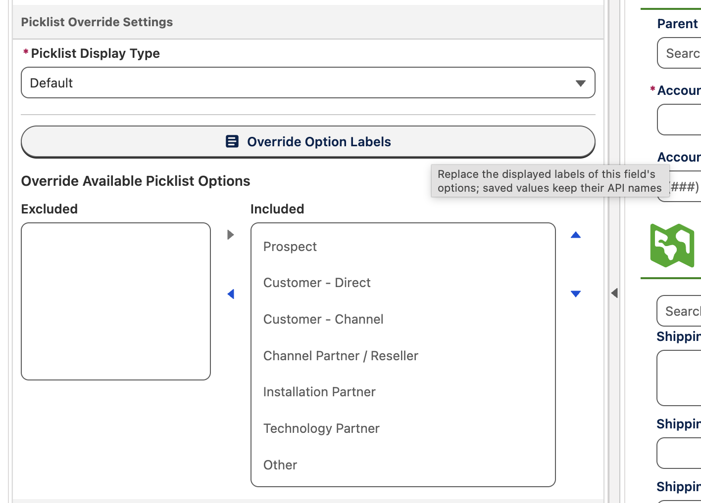
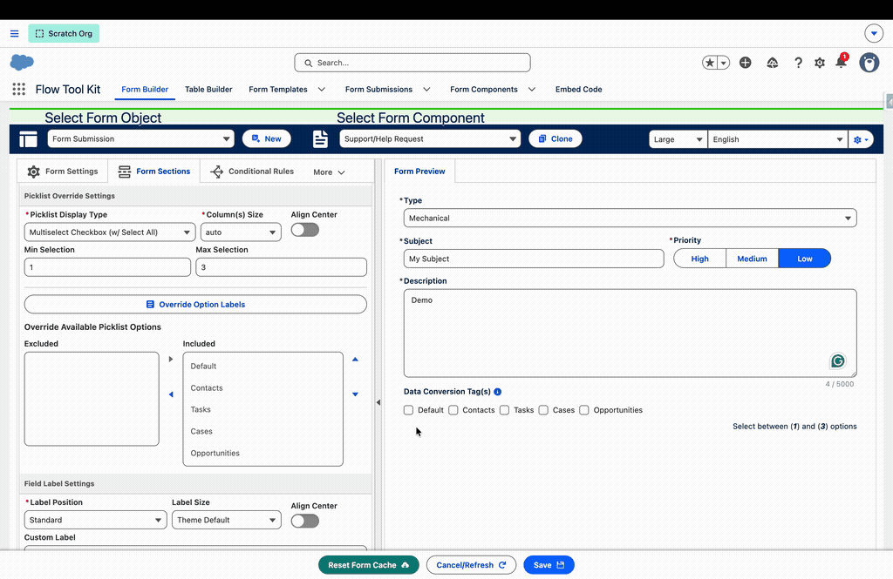
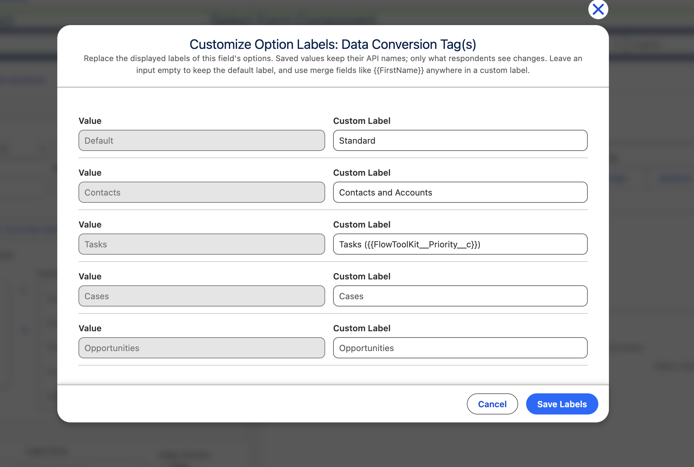

# Picklist Option Labels

For the upcoming survey release, the option-label dialog also supports explicit answer scores. See [Question Reporting](question-reporting.md#assign-scores-to-answer-choices) for a recorded five-choice example and how it connects to Results.

> Rename what respondents see in any picklist or multiselect, per form, without touching your org's metadata. Values stay API-safe for your automations and reports; labels become audience-friendly, and with merge fields they can even change live as the respondent fills out the form.

## Overview

Your org's picklist values are named for your database: "Customer - Direct", "Tier 2 Escalation", "FY26-Q3-Renewal". Your respondents should never have to read them. Custom Option Labels let you replace the displayed label of any picklist or multiselect option, per form, straight from Form Builder:

* The **stored value never changes**. Submissions, reports, record-triggered flows, and integrations keep receiving the exact API value they always have. Only what the respondent sees is different.
* Labels are **per form**, not per org. The same Status field can read as formal wording on a client-facing application and as internal shorthand on a staff intake form.
* Labels support **merge fields**, so an option's wording can react to the respondent's other answers in real time.
* No metadata deployments, no value renames, no admin change tickets. A form manager does it all in the builder in seconds.

This video rewords three answers on a survey question and shows the new labels in the preview:



## Configuring option labels

1. Open your form in **Form Builder** and select a picklist or multiselect field.
2. In **Picklist Override Settings**, click **Override Option Labels**. The button shows a count whenever the field already has custom labels, so you can spot overridden fields at a glance.
3. The editor lists every value with the read-only **Value** (the API name that gets saved), a **Custom Label** input whose placeholder shows the current default label, a **Score**, and a **Description** (see [Option descriptions](#option-descriptions)).
4. Type a custom label for any subset of values. Leave an input empty to keep the default; a respondent never sees a blank option.
5. Click **Save**, then save the form.

Labels can be up to 255 characters. If a saved override maps a value that is no longer active (or belongs to a different record type), the editor still shows it, flagged as inactive, so you can clear it deliberately; it is never silently dropped.

## Dynamic labels with merge fields

Custom labels run through the same merge pipeline as every other label in Flow Tool Kit, which means an option's wording can reference the respondent's own answers with `{{FieldApiName}}` tokens and re-resolve as those answers change.

In this example, a Data Conversion Tag option is labeled `Tasks ({{FlowToolKit__Priority__c}})`. The moment the respondent switches Priority from Low to Medium, the checkbox re-labels itself to "Tasks (Medium)":

This turns option lists into contextual UI: "Email a copy to \{{Email\_\_c\}}", "Schedule follow-up with \{{Contact\_1\_\_r.FirstName\}}", or any wording that should reflect what the respondent already told you.

## Option descriptions

A custom label renames an option; a description explains it. Write one in the **Description** box under each value in the same editor (or in **Customize Visual Picker** for a visual picker field), save, then save the form. An option with no description shows none.

This video writes two descriptions and shows each place respondents can see them:



Once a field has a description, **Option Description Display** appears under the editor button. Leave it on **Auto** and the form picks the place that suits the field's display type:

| Display type | Auto shows the description |
| --- | --- |
| Radio, multiselect checkboxes, select-all checkboxes, survey buttons, visual picker | Under each option, always visible |
| Radio buttons, separated buttons, icon buttons, multiselect badges | In a popup when the respondent hovers over or focuses the option itself (a tap shows it on a phone); no icon is added |
| Standard dropdown, multiselect combobox | As a second line under each option inside the dropdown menu |
| Dual listbox, path | The chosen option's description, under the field |

You can pick **Below Option**, **Hover Bubble** or **Below Field** instead. A choice the display type cannot draw falls back to Auto; **Below Field** works on every type.

Good practice:

* Keep descriptions to a sentence. Long text under every option makes a list hard to scan; use **Hover Bubble** when descriptions run long.
* On a standard dropdown, give every option a description. Salesforce notes the menu can look misaligned when only some options have one.
* Merge fields such as `{{FirstName}}` work, as in custom labels. Descriptions are plain text.
* Review screens and PDFs show the chosen label only; the description explains a choice, it is not part of the answer.
* A Likert matrix built on a picklist shows each option's description when the respondent hovers or focuses its column header.
* Descriptions live with the option's custom label and score in `Form_Component_Field__c.picklistOptionSettings__c` and travel with the form.
* Radio Buttons on a required field normally use Salesforce's button group. When the options have hover descriptions, the form draws its own buttons instead, so each option can open its popup; required validation works the same.

## How it works

* **Display-only, everywhere.** The override applies across every picklist display type: the standard dropdown, radio buttons, button groups, icon ratings, path, multiselect checkboxes, and the dual listbox. Both the available and selected sides of multiselects show the custom label.
* **Merge fields honor the custom label too.** When other content on the form renders the field's value through a `{{FieldApiName}}` merge (a confirmation message, a rich text block, a review screen), it displays the custom label, keeping the respondent's experience consistent end to end.
* **The data layer is untouched.** The Form Submission stores the API value. Salesforce reports, list views, and record pages continue to show your org's real (translated) picklist labels.
* **Works alongside the other picklist overrides.** Combine it with Override Available Picklist Options in the same settings block to subset, reorder, and relabel a field's options in one pass.

## Using it effectively

* **Write for the audience, not the database.** Grant portals, client intake, and volunteer signups each deserve their own phrasing of the same field. Configure each form's labels independently.
* **Shorten long value names.** Multi-part values like "Channel Partner / Reseller" can become "Reseller" on a narrow mobile layout without any org-wide rename discussion.
* **Add context with merge fields** where a static label would be ambiguous, especially on multiselects where each option is a decision of its own.
* **Pair with custom labels and translations.** Because overrides resolve through the standard label pipeline, `{{label:...}}` tokens and Form Label translations work inside them, so multilingual forms can localize option labels per language.
* **Leave most options alone.** Only override what needs it; empty inputs always fall back to the default label, so upgrades and new picklist values keep working with zero maintenance.

## Good to know

* Forms built before option descriptions keep working with no change. Their custom labels, scores and visual picker icons are read from the older settings until someone saves the option window again; from then on everything for that field is kept together in one place.

* If two different forms on the same page override the same field with different labels, each form's option list is always correct; merge-field text on that page resolves to the most recently rendered form's labels.
* A field hidden by conditional logic registers its labels for merge display once it first renders.
* Custom option labels live in the form's configuration (`Form_Component_Field__c.picklistOptionSettings__c`, one object per option holding its label, description, score and icon), so they travel with the form when you clone or migrate it. A form saved before that field existed keeps its labels in `picklistOptionLabels__c` until the option windows next save it.

## Related Pages

* [Field Labels Help Text](field-labels-help-text.md): custom field labels, merge fields, and translations
* [Field Type Settings](field-type-settings.md): display type overrides, including boolean true/false labels
* [Input Field Configuration](input-field-configuration.md): the full field settings reference
