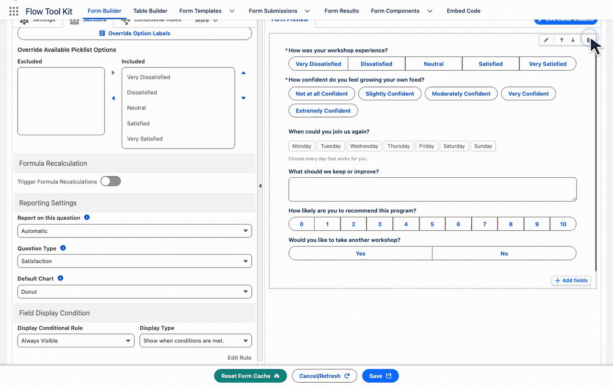
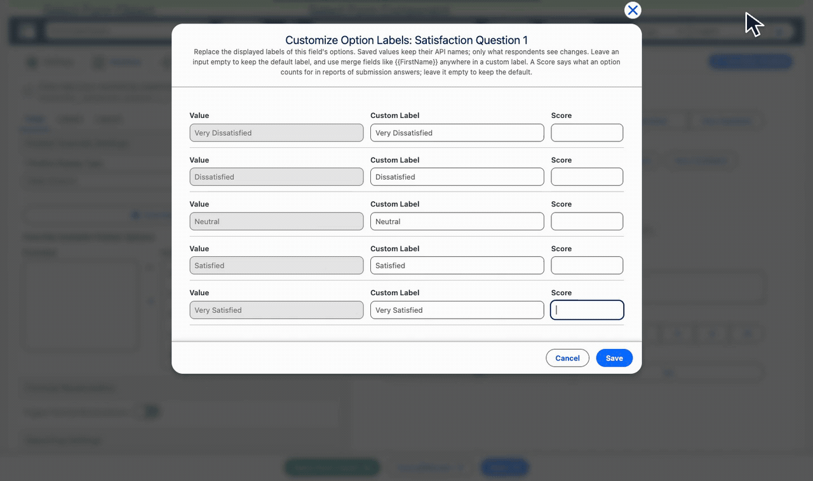
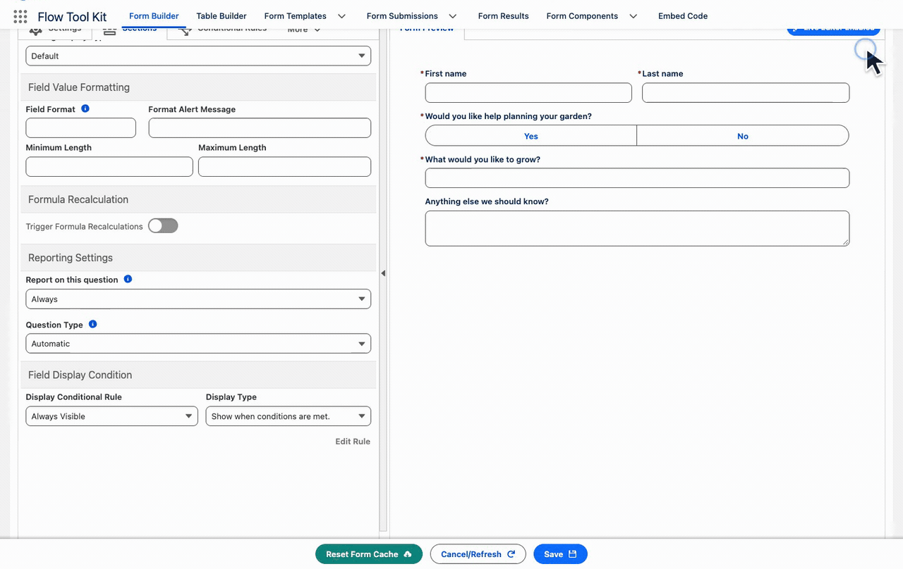

# Question Reporting

Use **Reporting Settings** in Form Builder to choose which Form Submission fields create reportable answers, how questions are classified, and which chart they use by default.

> Available in [Release 4.49](../release-notes/release-4.49.md).

First enable **Form Template Settings → Form Analytics → Enable Form Analytics** on the template. Question reporting settings only create answer records when that switch is on. Eligible answers are recorded when submission conversion is **Complete** or **Bypassed**, including questions in Custom mode sections. **Survey Section** controls the respondent presentation separately.

## Choose inclusion, question type, and chart

Select a question in **Form Builder**, open its **Field** settings, and find **Reporting Settings**.

| Setting | Purpose |
| --- | --- |
| Automatic | Uses the reporting defaults for the field. Administrative and identity fields are normally excluded. |
| Always | Includes the field in answer reporting. |
| Never | Excludes the field when new answer records are created. |
| Question Type | Classifies the question for reporting, such as Satisfaction or Confidence. |
| Default Chart | Sets the question's preferred chart type for reporting. |

With **Automatic**, these fields do not create answer records:

- **Contact identity:** Contact 1 and Contact 2 first name, last name, title, email, email type, phone, and phone type.
- **Record lookups:** Contact 1, Contact 2, Lead 1, Lead 2, Account, and Campaign.
- **Administrative fields:** Status and other packaged Form Submission fields without a question type.
- **Free-written text:** text responses are excluded by default. File uploads are included.

Choose **Always** to include one of these fields, or **Never** to exclude a field from new answer records. For your own exclusions in a Flow, use the **Skip Fields** input of [Create Form Submission Answers](../invocable-actions/form-submission-actions.md#create-form-submission-answers). Skip Fields takes precedence even over **Always**; the default exclusions above need no Skip Fields entry while their reporting setting is **Automatic**.

The workshop experience question uses **Always**, **Satisfaction**, and **Bar**. Save the form after changing these settings.

## Assign scores to answer choices

Open **Override Option Labels** for the choice field. Keep or customize its display labels, then enter the numeric **Score** for each choice. Save the option dialog and then save the form.

The example keeps the existing labels and assigns **Very Dissatisfied = 1** through **Very Satisfied = 5**. Those values match the example's default scale, so the explicit configuration does not change its existing totals. Plan scores before collecting responses and keep the scale consistent with what the question asks.

Use [Survey Results](../form-template-framework/survey-results.md#change-the-chart-view) to inspect the distributions and averages. A 0–10 recommendation question has different metric rules from a 1–5 satisfaction question.

## Exclude future answers with Never

Choose **Never** for a field that should remain on the submission but should not create new reporting answers. The signup example changes its first-name field from **Always** to **Never**, then saves the form.

This setting does not erase historical answers. In the verified example, an earlier response retains its name answer; a later response stores the name on the submission but creates no name answer record. After recalculation, the earlier answer still contributes one response. See the [hidden, blank, and historical-answer comparison](../form-template-framework/survey-results.md#read-question-results).
