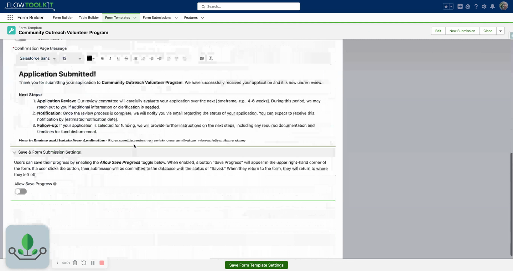

# Form Submissions

> Track, save, and resume form completion progress with a custom object structure that stores user responses across sessions.

## Overview

Form Submissions provide save-and-resume capability for Flow Tool Kit forms. When a user partially completes a multi-page form (via Form Templates) and needs to come back later, the Form Submission system stores their progress. When they return, the form reloads with their previous responses pre-filled.

The submission system is built on the `Form_Submission__c` custom object, which stores a reference to the Form Template and serialized field values. Combined with Form Templates, it enables long-running intake processes, applications, and surveys where users may not complete everything in a single session.

## Video Walkthrough



## Key Objects

### Form\_Submission\_\_c

The primary object that stores a user's form progress.

| Field               | Type          | Description                                                |
| ------------------- | ------------- | ---------------------------------------------------------- |
| `Form_Template__c`  | Lookup        | Reference to the Form Template being filled out            |
| `Status__c`         | Picklist      | Submission status (e.g., In Progress, Submitted, Approved) |
| `Submitted_By__c`   | Lookup (User) | The user who created/owns this submission                  |
| `Submitted_Date__c` | DateTime      | When the submission was completed                          |

_Additional fields store serialized form data and metadata for each page/section._

## Survey Question Fields

For the upcoming Survey and Results features, see [Survey Mode](survey-mode.md) for the respondent experience and [Survey Results](survey-results.md) for response totals, scores, and charts.

Form Submission includes reusable question families and a single Age Range field. Replace the question label in Form Builder with the wording respondents should see. Each field starts unanswered; choose whether an answer is required on the form.

| Fields | Answer choices, in order |
| --- | --- |
| `Importance_Question_1__c` through `Importance_Question_10__c` | Not at all Important; Slightly Important; Moderately Important; Very Important; Extremely Important |
| `Likelihood_Question_1__c` through `Likelihood_Question_10__c` | Very Unlikely; Unlikely; Neither Likely nor Unlikely; Likely; Very Likely |
| `Ease_Question_1__c` through `Ease_Question_10__c` | Very Difficult; Difficult; Neither Easy nor Difficult; Easy; Very Easy |
| `Confidence_Question_1__c` through `Confidence_Question_10__c` | Not at all Confident; Slightly Confident; Moderately Confident; Very Confident; Extremely Confident |
| `Yes_No_Question_1__c` through `Yes_No_Question_10__c` | Yes; No; Not Sure; Not Applicable |
| `Change_Question_1__c` through `Change_Question_5__c` | Much Worse; Somewhat Worse; About the Same; Somewhat Better; Much Better |
| `Expectations_Question_1__c` through `Expectations_Question_5__c` | Far Below Expectations; Below Expectations; Met Expectations; Above Expectations; Far Above Expectations |
| `Usefulness_Question_1__c` through `Usefulness_Question_5__c` | Not at all Useful; Slightly Useful; Moderately Useful; Very Useful; Extremely Useful |
| `Familiarity_Question_1__c` through `Familiarity_Question_5__c` | Not at all Familiar; Slightly Familiar; Moderately Familiar; Very Familiar; Extremely Familiar |
| `Age_Range__c` | Under 18; 18-24; 25-34; 35-44; 45-54; 55-64; 65 or Older; Prefer Not to Answer |

Use the scale families for individual questions or [Likert Matrix sections](../form-configuration/likert-matrix-sections.md). Their choices run from low to high. Change measures perceived improvement or decline, Expectations compares an experience with what was expected, Usefulness measures practical value, and Familiarity captures self-reported knowledge of a topic.

The Yes/No family preserves uncertainty and non-applicability separately from a blank answer; use Override Available Picklist Options to hide choices a particular question does not need. Age Range records the respondent's selected age band without requiring a birthdate. Prefer Not to Answer is a separate response from leaving the question blank.

Use these fields for survey responses with the current submission types; a separate **Survey** conversion type is no longer required. Form Builder Admin, Form Builder Manager, and Form Flow User grant read and edit access to these fields.

## How It Works

**Save Flow**:

1. User fills out form pages in a Form Template
2. User clicks "Save Progress"
3. Flow checks the `saveProgress` output from Form Template component
4. Flow creates or updates a `Form_Submission__c` record with current field values
5. User can close the browser and return later

**Resume Flow**:

1. User opens the flow or page again
2. Flow queries for their existing `Form_Submission__c` record
3. Passes the submission record to the Form Template component via `formSubmission` input
4. Component pre-fills all previously entered values
5. User continues where they left off

**Submit Flow**:

1. User completes all pages and clicks Submit
2. Flow processes the final field values
3. Flow updates the `Form_Submission__c` status to "Submitted"
4. Flow performs any final DML (record creation, email alerts, etc.)

## Works With

| Component             | Integration                                                         |
| --------------------- | ------------------------------------------------------------------- |
| **Form Templates**    | Primary consumer: templates produce and consume submission records |
| **Flow Form**         | Individual form instances within templates populate submission data |
| **Invocable Actions** | Use JSON Serialize/Deserialize actions to process submission data   |

## Common Patterns

### 1. Save and Resume Application

Create a flow that:

* Queries for existing submissions for the current user
* If found, passes it to the Form Template component
* On each screen interaction, checks `saveProgress`; if true, upserts the submission
* On final submit, processes all data and marks status as "Submitted"

### 2. Admin Review Queue

Build a list view or report on `Form_Submission__c` filtered to "Submitted" status. Admins open submissions and view completed forms in read-only mode using Form Template with `disableAll=true`.

### 3. Multi-Session Intake

For complex applications (grant requests, insurance claims), allow users to complete sections over multiple sessions. Each visit updates the same submission record. Include a progress indicator showing which pages are complete.

## Tips & Considerations

* **DML is Your Responsibility**: The Form Template component outputs submission data but does NOT automatically save to the database. Your Flow must handle Create/Update Records elements.
* **Serialization**: Form field values are serialized (typically as JSON) when stored in the submission record. The component handles serialization/deserialization transparently.
* **User Matching**: When resuming, query submissions by the current user's Id and the template Id to find the right record. Consider using a unique external Id for more complex matching.
* **Status Management**: Define clear status values (Draft, In Progress, Submitted, Approved, Rejected) to track where each submission stands in your process.
* **Experience Cloud**: Form Submissions work in Experience Cloud flows. Guest users may need special handling for submission ownership.
* **Cleanup**: Consider a scheduled flow or batch process to clean up abandoned submissions (e.g., "In Progress" for more than 30 days).

## Survey answer reporting

Turn on **Form Template Settings → Form Analytics → Enable Form Analytics** to create reporting answers when a submission's conversion is **Complete** or **Bypassed**. Use [Question Reporting](../form-configuration/question-reporting.md) to configure which fields contribute. This setting is independent of the section-level survey presentation. See [Survey Results](survey-results.md) for the reporting workflow. These features are prepared for the upcoming release.
