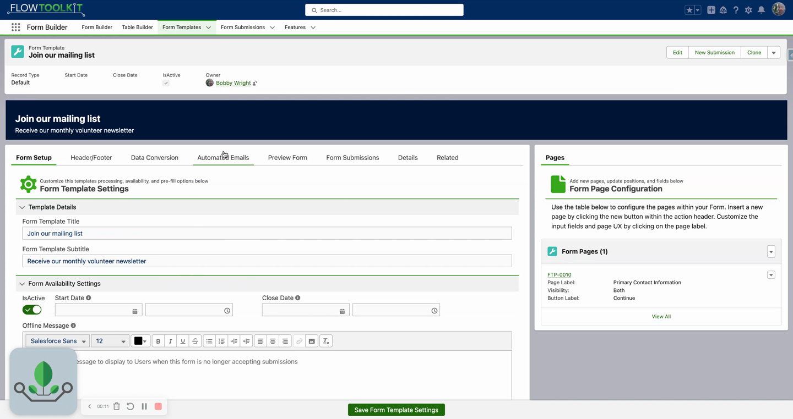

# Set Up Email Notifications

> Send automated emails when forms are submitted: to the submitter, an admin, or both.


**Prerequisites**: A Form Template with submissions. See [Build a Multi-Page Form](build-multi-page-form.md).


## Overview

Flow Tool Kit can send automated email notifications when a form submission occurs. Common use cases:

* **Confirmation to submitter**: "Thank you, we received your application"
* **Alert to admin**: "New submission received for \[Template Name]"
* **PDF attachment**: include the submission PDF in the email

## Video Walkthrough



## Step 1: Configure Email Templates



Create Salesforce email templates for your notifications:

1. Go to **Setup → Email Templates** (Classic or Lightning).
2. Create templates for each notification type.
3. Use merge fields to include submission data in the email body.

## Step 2: Link Templates to Your Form Template

1. In the Form Template configuration, navigate to the email notification settings.
2. Configure notification rules:

| Setting            | Description                                                 |
| ------------------ | ----------------------------------------------------------- |
| **Recipient**      | Who receives the email (submitter, admin, specific address) |
| **Email Template** | The Salesforce email template to use                        |
| **Trigger**        | When the email sends (on submission, on conversion, both)   |
| **Attach PDF to Confirmation Email** | Attach a PDF of the answers to the confirmation email ([below](#attach-a-pdf-of-the-answers-to-the-confirmation-email)) |

## Step 3: Test

1. Submit a test form.
2. Check the recipient's inbox for the notification.
3. Verify merge fields populated correctly.
4. If attaching PDFs, verify the attachment is present and readable.

## Attach a PDF of the answers to the confirmation email

This video turns the setting on, sets the confirmation's running user, and opens the PDF on a submission.



Turn on the **Attach PDF to Confirmation Email** toggle in the Form Template's **Confirmation Email Settings** card. It sits directly below the **Send Confirmation Email** toggle, above **Recipients (Confirmation Email)**. Attach PDF and Recipients show only while Send Confirmation Email is on; turn Send off and both are hidden. Each confirmation email then carries a PDF of the respondent's answers.

**What the PDF contains:** the Form Submission Simple Print page. The template's name, the submission number and date, then every page and section of the form, each question label with the respondent's answer.

**Where else it goes:**
* The PDF is saved in the submission's **Files**, named `<Form Template Name> - <Submission Number>.pdf`, and shared with **All Users**: anyone who can see the submission can open it, including site users.
* The submission remembers that file in **Answers PDF Id**. If a confirmation is ever sent again for the same submission, the new PDF is saved as a **new version of the same file**, and the email carries the newest version. If someone deleted the file, a new one is made and remembered instead.
* The email that went out is logged on the recipient's timeline with the file attached.

**If the PDF cannot be made, the email still goes out**, without the attachment, and the submission still converts. The submission's **Conversion Log** gets a warning that says so, names the usual cause, and points here:

> ⚠️ The confirmation email was sent without the PDF of the answers, because the PDF could not be made. This usually means the confirmation runs as Salesforce's Automated Process user, which cannot open the PDF page. To attach the PDF, set the Form Submission Convert event's running user to a regular user, such as a system administrator: deploy a Platform Event Subscriber Config, then Suspend and Resume the trigger. The steps are in the Flow Tool Kit docs, Set Up Email Notifications, under "Set the conversion's running user". Salesforce's reason: *(the platform's message)*

### Set the conversion's running user


**Required once per org before the PDF can be attached.**


**What it is.** Confirmation emails are sent by the conversion. When a form is submitted, Flow Tool Kit publishes a **Form Submission Convert** platform event, and the package's `Form_Submission_Convert` trigger runs the conversion and the confirmation email. Salesforce runs a platform event trigger as a special system user, **Automated Process**, unless you name a different **running user** for it.

**Why it's needed.** Salesforce limits what the Automated Process user can be given: it has no profile and you can't assign it permission sets, so it can't be granted access to the package's Apex classes. The PDF is drawn by a Visualforce page whose controller is one of those classes, so under Automated Process the page refuses to open ("You do not have sufficient privileges to access the controller") and no PDF can be made. Naming a regular user as the running user fixes this. Everything else in the conversion works either way.

**What changes for the conversion.** It runs as the user you name:
* Records it creates or changes show that user as Created By and Last Modified By.
* New records it owns get that user as their owner.
* The Conversion Log rows are created by that user.

The trigger still runs in system context, so the user's own object and field permissions don't limit the conversion.

**How it's set.** With a **Platform Event Subscriber Config**. Salesforce has no Setup screen that creates one: you deploy it with **Metadata API** (or create it with Tooling API). Setup only shows the result and lets you Suspend and Resume the trigger. Salesforce's own pages: [Configure the User and Batch Size for Your Platform Event Trigger](https://developer.salesforce.com/docs/atlas.en-us.platform_events.meta/platform_events/platform_events_trigger_config.htm) and the [PlatformEventSubscriberConfig metadata type](https://developer.salesforce.com/docs/atlas.en-us.api_meta.meta/api_meta/meta_platformeventsubscriberconfig.htm).

1. **Pick the user.** An active user with the **System Administrator** profile. Choose a user who will stay active; if that user is deactivated, set a new one the same way.
2. **Create the file** `platformEventSubscriberConfigs/Form_Submission_Convert_Running_User.platformEventSubscriberConfig-meta.xml` in an SFDX project, with that user's username:

    ```xml
    <?xml version="1.0" encoding="UTF-8"?>
    <PlatformEventSubscriberConfig xmlns="http://soap.sforce.com/2006/04/metadata">
        <masterLabel>Form Submission Convert Running User</masterLabel>
        <platformEventConsumer>FlowToolKit__Form_Submission_Convert</platformEventConsumer>
        <user>admin.username@yourorg.com</user>
    </PlatformEventSubscriberConfig>
    ```
3. **Deploy it:** `sf project deploy start --source-dir platformEventSubscriberConfigs --target-org <your org>` (or the deploy tool you already use).
4. **Suspend and Resume the trigger** so the new user takes effect at once:
    1. Go to **Setup → Platform Events → Form Submission Convert**.
    2. In **Subscriptions**, click **Manage** next to `Form_Submission_Convert`.
    3. Click **Suspend** and confirm, then **Resume** and confirm.

    Without this, Salesforce can take an unspecified time to pick up the change. Resume processes any event that arrived while the trigger was suspended, so nothing is lost.
5. **Check it:** back on the event page, the **Subscriptions** list shows your user in the **User** column. Submit a test form: the Conversion Log rows are created by that user, and the confirmation email arrives with the PDF attached.


**Overriding the send flow?** If your org overrides `(Form Submission) Convert | Utility | Send Email | Overridable`, your override replaces the packaged flow and gets no PDF until you copy the new steps into it:
* **Switch (Attach PDF)**
* **Get Answers PDF**
* **Generate PDF**, with its fault path **Log Warning (PDF Not Attached)**
* **Assign PDF Attachment**
* **Update Answers PDF Id**
* The **Attachment ID** value on **Send Confirmation Email**


## Notification Types

| Type                  | Recipient      | Typical Content                                      |
| --------------------- | -------------- | ---------------------------------------------------- |
| **Confirmation**      | Form submitter | "Thank you for your submission. Reference #12345."   |
| **Admin Alert**       | Internal team  | "New submission for \[Template]. Review at \[link]." |
| **Conversion Notice** | Submitter      | "Your application has been approved/processed."      |

## Tips


**Email deliverability**: Ensure your org's email deliverability is set to "All Email" (Setup → Deliverability). Sandbox orgs default to "System Email Only" which blocks non-system emails.


* **Test in sandbox first**: email notifications in production can't be undone
* **Use org-wide email addresses**: set a professional "From" address instead of the running user's email
* **Rate limits**: Salesforce has daily email limits per org. High-volume forms may hit these limits.

## Related Pages

* [Use Form Submissions](use-form-submissions.md): submission lifecycle
* [Create PDF from Submission](create-pdf-from-submission.md): attach PDFs to emails
* [Build a Multi-Page Form](build-multi-page-form.md): template creation
