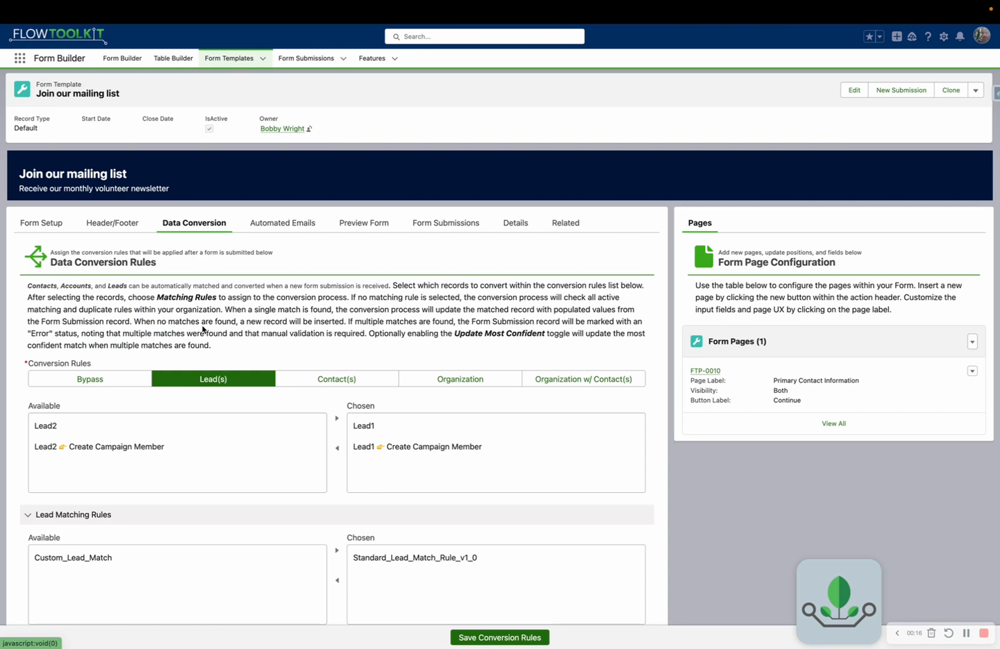
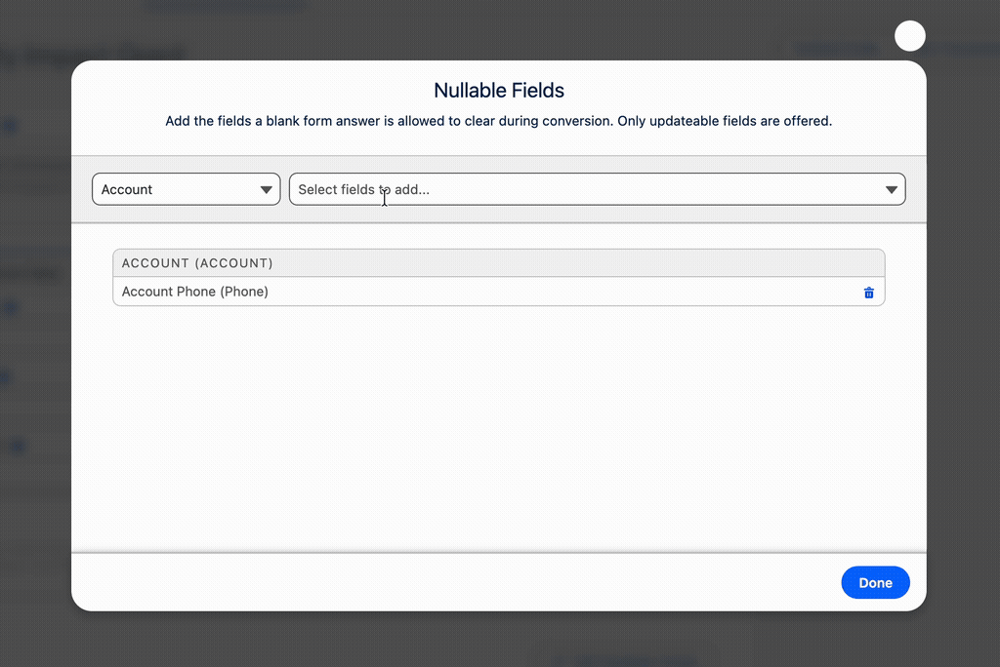
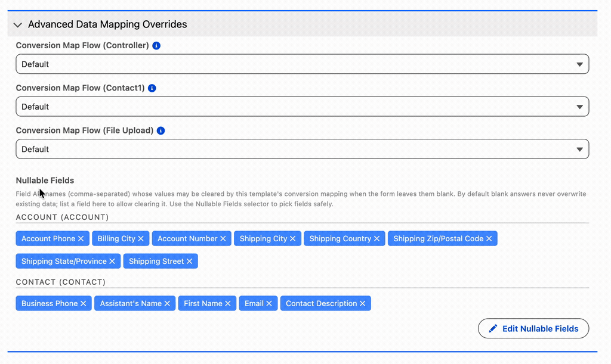

# Submission Conversion

> Transform completed Form Submissions into Salesforce records: Accounts, Contacts, Leads, Cases, or custom objects.

## Video Walkthrough



## Overview



Submission conversion is the process of taking a completed `Form_Submission__c` record and creating actual Salesforce records from the stored form data. This is the bridge between "user filled out a form" and "records exist in Salesforce."

## Conversion Lifecycle

```
Form Submission (Status: Submitted)
    ↓ Conversion triggered
Field values mapped to target object(s)
    ↓ Records created
Form_Submission_Conversion_Log__c entries recorded
    ↓ Status updated
Form Submission (Status: Complete)
```

## Conversion Methods

### Automatic Conversion

Conversion triggers automatically when a submission reaches "Submitted" status. This is configured at the template level and runs as a platform event-driven process.

### Manual Conversion

An admin or manager reviews the submission first, then triggers conversion manually. This allows for quality checks, edits, and approval before records are created.

## Conversion Rules

Conversion rules define the mapping between form fields and target object fields:

| Rule Property     | Description                                                              |
| ----------------- | ------------------------------------------------------------------------ |
| **Target Object** | Which Salesforce object to create (Account, Contact, Lead, Case, custom) |
| **Field Mapping** | Which form field maps to which target field                              |
| **Status Field**  | Which field on the submission tracks this conversion's status            |
| **Lookup Field**  | Which field on the submission stores the created record's Id             |

### Multi-Object Conversion

A single submission can convert to multiple objects. For example, a grant application might create:

1. A Contact record
2. An Account record (linked to the Contact)
3. A custom Grant\_Application\_\_c record (linked to both)

Each target object has its own conversion rule, field mapping, and status tracking.

## Nullable Fields (clearing values with blank answers)

Conversion mapping is protective by default: every packaged conversion flow runs the [Strip Null Values](../invocable-actions/collection-data-utilities.md#strip-null-values) action before writing, so a blank form answer never wipes data already on a matched record. **Nullable Fields** is the opt-out for the cases where blank *means* clear it - a respondent emptying their phone number, unchecking a consent box, or removing an assistant's name.

### Configuring on the Form Template

Open the Form Template record page and find **Nullable Fields** under **Data Conversion Settings → Advanced Data Mapping Overrides**. Click **Edit Nullable Fields** to open the selector:



- The **object picker** offers every accessible object in your org - conversion can target anything, not just the packaged objects.
- The **field picker** offers only fields that are valid and updateable on the chosen object, so a selection can never produce a conversion error.
- Chosen fields group into a card per object, and the read view shows them as badges grouped under each object with inline remove:



During conversion, every packaged conversion flow (Account, Contact, Lead, Case, Opportunity, and Campaign Member) passes the template's Nullable Fields value into its Strip Null Values calls automatically. When a listed field arrives blank, the matched record's value is cleared - checkboxes are set to `false`, since a checkbox cannot hold null. Fields not listed keep the full strip-null protection.


Conversion flows you cloned from the packaged **Overridable** flows before this feature shipped do not have the binding. Add the template's `Nullable Fields` field to each **Remove Null Values** action's **Nullable Fields (CSV or JSON)** input in your override.


### Extending to your own objects and flows

The selector is not tied to the Form Template. Any field whose API name contains `Nullable_Fields__c` renders the same selector automatically - in the Form Builder and on any record form:

1. Create a **Long Text Area** field named `Nullable_Fields__c` on any standard or custom object (a plain Text field works too).
2. Add it to a form in the Form Builder. The field renders as the Nullable Fields selector - no configuration required.
3. Optionally set a **Scoped Object** under the field's **Nullable Fields Settings** in the builder. Scoped mode locks the selector to that one object and stores a simple comma-separated list; leaving it **Universal** keeps the object picker and stores an object-keyed JSON map.
4. In your own flow, pass the field's value into the Strip Null Values action's **Nullable Fields (CSV or JSON)** input before your Update Records element.

### Building the list directly in Flow

The selector is a convenience, not a requirement - the action input is a plain string an admin can assemble in Flow:

- **Comma-separated names** for a single object, from a formula or Text Template:

  ```
  Email, Phone, Description
  ```

- **An object-keyed JSON map** when one string feeds strips of different objects - only the entry matching each stripped record's object applies, and a `"*"` key applies to any object:

  ```json
  {"Account":["Phone"],"Contact":"Email,Title","*":["Description"]}
  ```

- **Combine sources dynamically**: bind the template's stored value for the defaults and append per-interview additions with a formula - for example `{!FormTemplate.Nullable_Fields__c}` when the template list is all you need, or a formula that concatenates extra names onto a CSV.

Misconfigurations fail loudly rather than silently: a name that is not a valid, updateable field on the stripped record's object - or JSON that does not parse - faults the flow with a `Nullable Fields:` error identifying the field and object. Blank values, a bare comma, and an empty map (`{}`) are safe no-ops, so conditional formulas that sometimes produce nothing are fine.

## The Conversion Event Action

Every step of the pipeline runs through one invocable action - **Form Template | Conversion Event** - called in one of four modes:

| Mode                     | What it does                                                                                                       |
| ------------------------ | ------------------------------------------------------------------------------------------------------------------ |
| **Start**                | Kicks off the pipeline: resets every conversion status to Ready and sends the submission to its controller flow    |
| **Convert to Record**    | Dispatches the submission to a conversion flow (packaged default or your override) that builds one record          |
| **Log**                  | Records a step's outcome - success or error - and optionally stamps a status field and the created record's lookup |
| **Return to Controller** | Hands control back so the controller evaluates the next rule                                                       |

The packaged flows are ordinary autolaunched flows built from these calls, so customizing conversion means cloning a readable flow and editing it - the action's property editor guides each mode's inputs, including a grouped conversion-flow picker and automatic binding of the standard `FormSubmission`/`FormTemplate` variables.

Campaign Member conversion chains directly from the Contact and Lead upserts: as soon as a person converts, their membership follows - no separate controller pass.

### Transaction Mode

A **Convert to Record** call has a **Transaction Mode**, chosen under its Conversion Flow. A transaction is everything Salesforce saves together: if anything in it fails, all of it is undone and nothing is half saved.

| Mode | What happens | Choose it when |
| --- | --- | --- |
| **Synchronous** (default) | The conversion flow runs in the same transaction as the step before it, then hands control back to the controller, which picks the next rule. | Most conversions. |
| **Asynchronous** | The conversion flow gets a transaction of its own, with its own limits, and still hands control back. What earlier steps saved stays saved if this one fails. | The step is heavy, makes a callout, or is likely to fail without the rest having to fail with it. |
| **Inline** | The conversion flow runs right here, and when it finishes your flow carries on with the next element. Its Return to Controller does nothing. A step that logs an error stops every element after it and leaves the reason on the submission; that step's own changes are undone, earlier steps stay. | You list the steps one after another in a single flow. |

To carry on past a failing Inline step, add a fault path to its Convert to Record action and log the fault there.

## Conversion Log

Every conversion attempt is logged in `Form_Submission_Conversion_Log__c`:

| Field             | Description                         |
| ----------------- | ----------------------------------- |
| **Submission**    | The source submission               |
| **Target Object** | Object that was created             |
| **Record Id**     | Id of the created record            |
| **Status**        | Success or Error                    |
| **Message**       | Details about the conversion result |

Dispatch steps are silent, so the log reads chronologically: **Start once, each outcome (Created / Matched / Updated or an error), then Finish.** Related-record rows log against both the row and its parent submission, so parent-level monitoring covers every row.

## Error Handling

When a conversion fails (missing required fields, validation rule violations, duplicate rules):

1. The conversion log records the error
2. The submission status reflects the failure, and Finish never marks a conversion Complete while it carries an error
3. The submission can be corrected and re-converted

**A confirmation email that cannot be sent never fails the conversion.** The send is logged as an error row so you can find it and fix the cause (a bad address, a bounced contact email, a missing email template), and you can send the email by hand from the activity timeline; the submission still reads Complete. To log any other error the same way, tick **Record this error and carry on: it does not fail the conversion** on a Log action. That is rarely what you want.

**How we treat faults.** The package handles a fault so the person submitting the form never sees it fail: the submission is left in Error with the reason, and Reprocess picks it up. It does not hide the fault from you. A step that stops an Inline run is an unhandled fault on purpose, so it appears in Setup's list of failed flow interviews and Salesforce emails your flow error recipients. Treat those as a to-do list: a fault means a gap in the process, such as a validation rule the form does not enforce or data a step needs and does not get, and the goal is to close it so the fault stops happening.

### Your own fields on Form Submission

Your custom fields on Form Submission reach your override flows as before, with two exceptions the Setup action cannot help:

| Field | What happens | What to do |
| --- | --- | --- |
| A field whose API name matches one of ours without the prefix, for example your `Submitted_By__c` beside `FlowToolKit__Submitted_By__c` | The package cannot read it: inside the package the bare name means our field. It is left out of the record the Setup action hands to your flow, and a debug log says so | Read it in your own flow with a Get Records on the submission, or give it a name of your own |
| A custom Address or Geolocation field | Flow cannot pass a record holding one into an action, so the whole field is left out | Its parts (street, city, latitude, longitude) are on the record as usual |

Before this release both cases stopped every conversion in the org with "duplicate field selected" or "A field wasn't found or isn't supported for Apex action".

## Record types and duplicate rules

The Contact engine looks up the record type a template names, checks that it exists, and then saves the Contact **without** writing `RecordTypeId`. That is deliberate: a packaged flow cannot reference `RecordTypeId` on a standard object without failing to install in every org that has no record types on it, and the package has to install everywhere. Two things follow:

- **A duplicate rule with a Record Type condition never sees a form conversion.** Matching runs against the Contact as the engine built it, with no record type, so a rule that requires `Record Type equals Individual` is skipped and no match is found, even when the org holds an obvious one.
- **The saved Contact takes the running user's default record type**, not the template's.

The remedy is yours, in one of two places: take the Record Type condition off the duplicate rules you want to apply to conversions, or set `RecordTypeId` in your own step-flow clone, from a Get Records on RecordType mapped in the Transform (see the NPSP and Nonprofit Cloud Customizing pages). The Nonprofit Cloud extension is not affected: Person Accounts require a record type and its step flows map it.

## Nonprofit Cloud

Nonprofit Cloud models people and families differently: a person is a Person Account, a family is a Household with a Party Relationship Group, and membership and family relationships are records in their own right. The **Nonprofit Cloud Extension** teaches this pipeline that shape, using the same Conversion Rules, statuses, logs and Reprocess described above. See the [Nonprofit Cloud Extension overview](../nonprofit-cloud/overview.md).

## Survey answers and stored results

For the upcoming survey release, **Enable Form Analytics** in Form Template Settings controls whether reportable questions create **Form Submission Answer** records. Answers are created when conversion reaches **Complete** or is **Bypassed**. The former **Survey** conversion type is no longer used. Section-level **Survey Section** controls presentation independently of analytics.

Reporting settings govern which questions create answers; changing a field to **Never** does not delete earlier answers. A completed response on a template with analytics disabled does not create new reporting answers.

Stored Results are a separate step. They are worked out again for the template about two minutes after its answers are written, and **Refresh results** on the Analytics panel works them out at once. **Form Template | Recalculate Results** in a scheduled Flow works out every template and is the nightly safety net. See the [recorded submission and recalculation walkthrough](survey-results.md#submit-convert-and-recalculate) and [Question Reporting](../form-configuration/question-reporting.md).

## Related Pages

* [Nonprofit Cloud Extension](../nonprofit-cloud/overview.md): Person Accounts, Households and relationships
* [Form Submissions](form-submissions.md): submission object reference
* [Use Form Submissions](how-to/use-form-submissions.md): end-to-end guide
* [Overridable Conversion Flows](how-to/overridable-conversion-flows.md): custom conversion logic
* [Form Submission Actions](../invocable-actions/form-submission-actions.md): invocable actions for logging events
* [Form Template Mapping](form-template-mapping.md): the Apply Submission Field Maps action fills fields from mapped page sections
