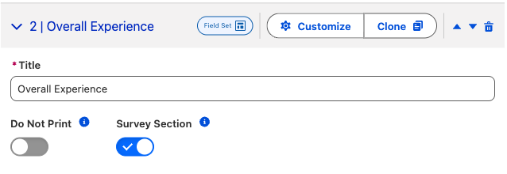
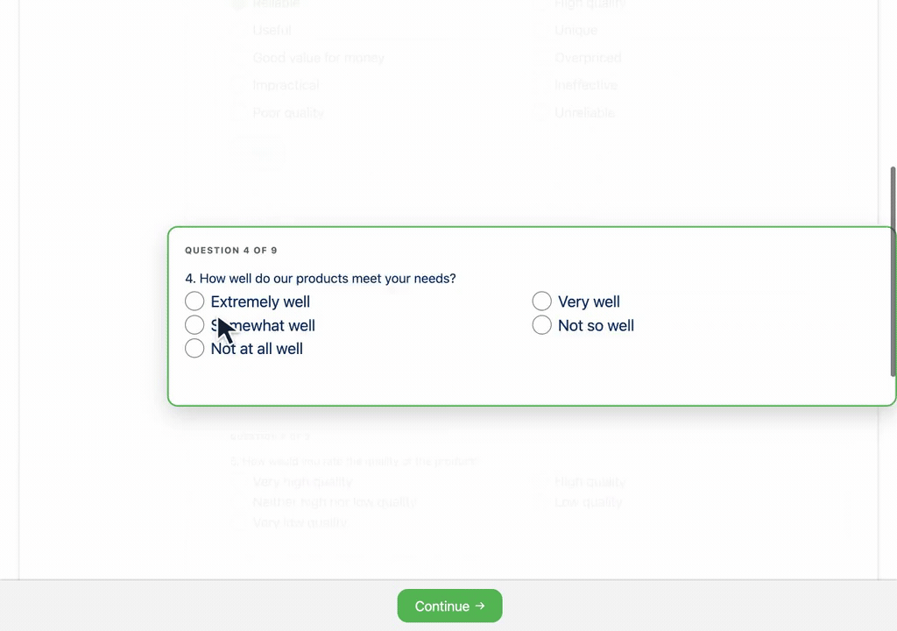
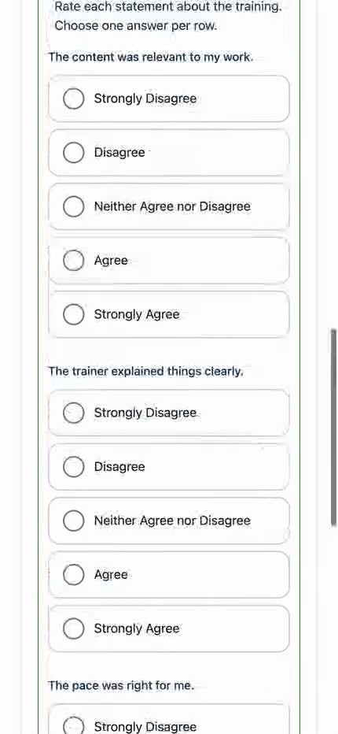
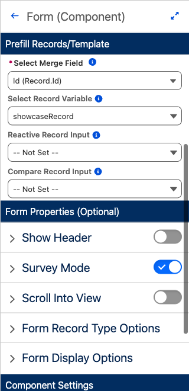
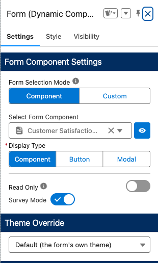
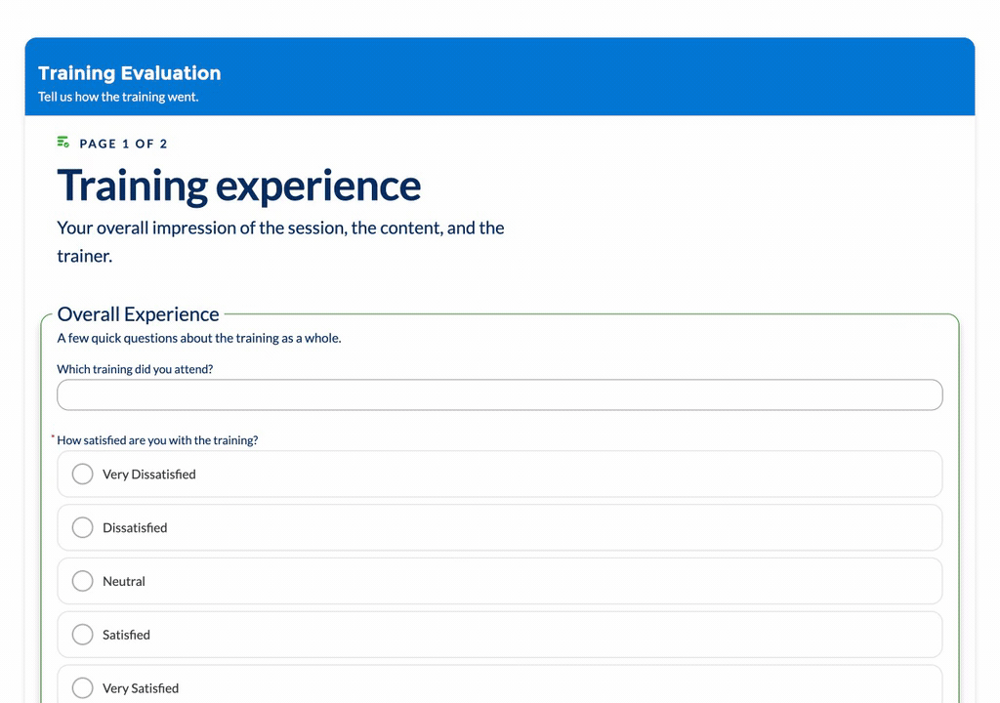
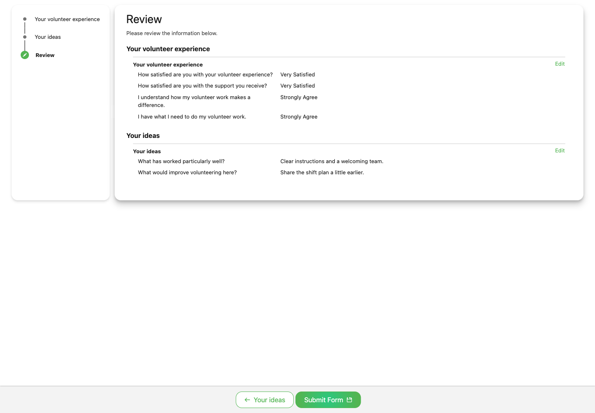

# Survey Mode

Survey Mode helps respondents focus on one question at a time. Enable it separately for each section with **Survey Section**. A page opens in its ordinary layout, without cards or an overlay. Entering a question brings up its card and covers the surrounding form with a 95 percent white veil.

> Upcoming release. Survey Mode is not assigned a package version yet.

## Enable it on a Form Template

1. Open the **Form Template** record and choose a page from **Form Pages**.
2. In **Page Sections**, expand the section you want to present as a survey.
3. Enable **Survey Section** beside **Do Not Print**. Each control has its label above the switch and a help icon.
4. Open a fresh response to check that section's questions and transitions.

The same controls appear in **Customize → Component**. The former template-level **Survey Mode** switch is no longer in Form Template Settings. Survey presentation and answer reporting are configured separately.

## Answer a survey

Scrolling alone does not select a question. Click or Tab into a field to focus it. The active card has a border, a question number, and a **Required** or **Answered** indicator where applicable. Click the white veil to return to the ordinary page layout.

Written answers use question-level **Next**. A single-choice answer is selected and advances focus with one click. Multi-select questions stay active while respondents choose answers, then use **Next**.

The form's navigation bar remains separate and usable. **Continue** advances to the next page; **Submit** sends the response. The recording above stops before submission.

## Move between sections

Completing the last question of a section brings the next survey section into view as a whole. Respondents can then enter a question in that section. A section with a single question, including a matrix, stays together with its heading; the veil remains outside the section.

## Required answers and returning to a question

The **Required** indicator identifies questions that need an answer. Clicking the veil lets respondents return to the page and select an earlier question. **Answered** identifies completed questions when revisiting them.

Keyboard users can Tab through the text field, its **Next** button, the answer groups, matrix rows, and the form's navigation buttons. Focus follows these controls without trapping the respondent inside a card.

## Check the mobile layout

At a narrow width, question cards fit the available space and the matrix presents each statement with its answer choices underneath. Scroll through the statements and choose an answer for each.

## Enable it in a screen Flow

For a standalone **Form (Component)** on a Flow screen, select the component in **Flow Builder**, expand **Form Properties (Optional)**, and enable **Survey Mode**. This switch applies to that standalone form placement. Save and activate the Flow through your usual release process.

When a Flow renders a **Form Template**, configure **Survey Section** on the template's individual page sections instead. The Training Evaluation recording above uses the Form Template Flow. Question-level **Next** and the form's **Continue** or **Submit** controls perform separate actions.

## Enable it in Experience Cloud

For a standalone **Form (Dynamic Component)**, select the component in **Experience Builder** and enable **Survey Mode** in its properties. This switch applies to the whole standalone form placement. Publish through your usual release process.

For a **Form Template**, configure the template's **Survey Section** controls, then verify the form in its actual site placement. This inline Aura example shows the same card, veil, single-choice, and matrix behavior as the Flow example.

For a public form, complete the [Guest Forms Quickstart](../how-to-guides/guest-forms-quickstart.md), including record sharing and the guest save flow. Test guest access separately from the signed-in administrator's view.

## Review and submit

A template with **Enable Review Screen** on shows read-only answers with **Edit** buttons before submission. The review page does not use survey cards or a veil.

## Choose fields and review results

**Survey Section** controls presentation. **Form Template Settings → Form Analytics → Enable Form Analytics** controls whether eligible answers create reporting records when conversion is **Complete** or **Bypassed**. The former **Survey** conversion type is no longer required.

Use the reusable [survey question fields](form-submissions.md#survey-question-fields), configure [question reporting](../form-configuration/question-reporting.md), and open [Survey Results](survey-results.md) to review answers and charts.
