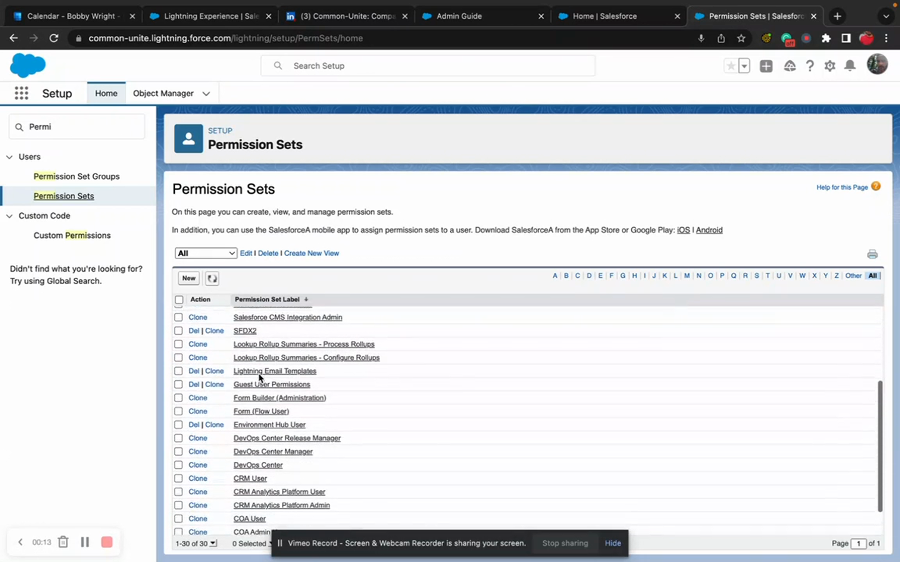
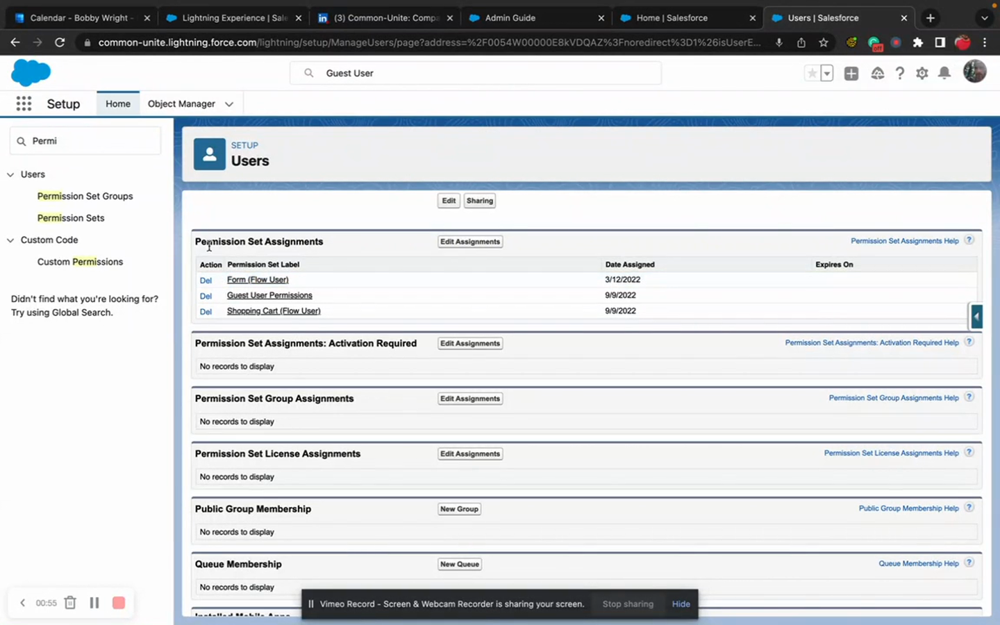

# Permission Sets

> Flow Tool Kit includes four permission sets. Assign them based on what each user needs to do.


**Prerequisites**: Flow Tool Kit must be installed in your org. See [Installation](installation.md).


## Video Walkthrough



## Overview

| Permission Set           | For                              | Summary                                                                                             |
| ------------------------ | -------------------------------- | --------------------------------------------------------------------------------------------------- |
| **Form Builder Admin**   | System Administrators            | Full access: build forms, manage templates, admin utilities, cache management, metadata operations |
| **Form Builder Manager** | Delegated admins / form builders | Build and manage forms and templates; no admin utilities or setup access                           |
| **Form Builder Internal User** | Internal users who work with form data | View templates, work with every submission and its answers, use Form Analytics; cannot build components or change templates |
| **Form Flow User**       | End users who fill out forms     | Minimum runtime access: render forms, submit data, use invocable actions in flows                  |


**A fifth, single-purpose set.** The package also includes **Form Style Defaults Manager**, which only lets a user save the org-wide form style defaults on Form Builder's Global Styles tab. Form Builder Admin already includes that access, so most orgs never assign it on its own.


## Form Builder Admin

**Assign to**: System Administrators and users who need full control over Flow Tool Kit.

This is the most permissive set. It grants:

* **56 Apex class accesses**: all runtime, builder, and admin utility classes
* **478 field permissions**: full read/edit on all Flow Tool Kit fields
* **14 object permissions**: full CRUD on all Flow Tool Kit objects
* **5 custom tabs**: Form Builder, Form Components, Form Submissions, Form Templates, Table Builder
* **6 Visualforce pages**: CacheFlow (cache management), Form Submission Print, Form Template Clone/Export/Import
* **User permissions**: Access Content Builder, Modify Metadata, View Roles, View Setup

## Form Builder Manager

**Assign to**: Non-admin users who need to build, edit, and manage forms and templates.


**Delegated Admin Pattern**: Form Builder Manager is designed for power users who aren't System Administrators but need to create and manage forms for their teams. They can do everything a form builder needs (create forms, manage templates, configure fields) without requiring admin-level org permissions.


This set grants:

* **47 Apex class accesses**: all runtime and builder classes, excluding admin utilities
* **477 field permissions**: read/edit on nearly all Flow Tool Kit fields
* **14 object permissions**: full CRUD on all Flow Tool Kit objects (same as Admin)
* **No custom tabs**: tabs must be assigned separately or via an app
* **No Visualforce pages**: no cache management or template import/export
* **No setup permissions**: no View Setup, Modify Metadata, or Content Builder access

Form Builder Manager users can:

* Create, edit, and delete forms in Form Builder
* Configure fields, sections, conditional logic, and themes
* Create and manage Form Templates (multi-page forms)
* Manage Form Submissions (review, convert)
* Use all Invocable Actions in Flows
* Access all Form Tool Kit objects and fields

Form Builder Manager users **cannot**:

* Reset the form cache (the **Reset Form Cache** button in Form Builder, gated on the **Form Component Admin** custom permission)
* Clone/export/import Form Templates via Visualforce pages
* Access Salesforce Setup pages
* Modify metadata

## Form Builder Internal User

**Assign to**: internal Salesforce users who review submissions and results but do not build forms.

This set sits one step below Form Builder Manager. It grants every field Manager does, so nothing on a submission is hidden, and leaves out the building.

Form Builder Internal User users can:

* View Form Templates, their pages and their form components
* Create, edit and delete Form Submissions and their answers, and review and reprocess them
* Use Form Analytics in full, including the Campaign filter and the Compare view
* See the Campaign a submission, an answer and a stored result belong to
* Open the Form Analytics, Form Submissions and Form Templates tabs

Form Builder Internal User users **cannot**:

* Create or edit form components (no Form Builder, Table Builder or Form Components tab)
* Create, edit or delete Form Templates, pages or page sections
* Import Form Templates
* Access Salesforce Setup or modify metadata


**Internal users only.** This set grants access to the Campaign object, which some Experience Cloud licenses cannot hold. Do not assign it to portal users or the Guest User. They use Form Flow User.


## Form Flow User

**Assign to**: End users who interact with forms in Flows but never build or manage them.

This is the minimum set needed for form rendering at runtime:

* **36 Apex class accesses**: runtime classes only (form rendering, data operations, invocable actions)
* **446 field permissions**: read/edit on fields needed for form submission and interaction
* **11 object permissions**: runtime objects only (excludes Campaign, Form\_Submission\_Conversion\_Log\_\_c, and deployment events)
* **No custom tabs, Visualforce pages, or setup permissions**

Form Flow User grants access to these invocable action classes:

* Collection Subset, Remove Nulls
* DateTime/Epoch conversions
* Duplicate Check, Merge Records
* File Upload handlers
* Get SObject Type, Record Types
* Upsert Bypass Duplicates
* Form Submission Data
* Form Configuration and Repeater Configuration


**Common mistake**: Forgetting to assign Form Flow User to end users. If a user can't see form fields or gets "Insufficient access" errors when filling out a form in a Flow, check their permission set assignment first.


### No Campaign Access

Form Flow User is the base set for everyone who fills out a form: internal users, portal users and the Guest User. It holds only access that every license can have. Some Experience Cloud licenses cannot reach the Campaign object, so this set grants no access to Campaign and no access to any field that looks up to a Campaign.

What that means in Form Analytics for a user whose only set is Form Flow User:

* The charts, the numbers and the View report links work, and cover every answer.
* There is no Campaign filter and no Compare view.

To give an internal user the Campaign filter and Compare, assign **Form Builder Internal User**. For a portal user whose license can reach Campaigns, create a permission set in your own org that grants Read on Campaign and on the Campaign fields of Form Submission, Form Submission Answer and Form Template Result, and assign it alongside Form Flow User.

### Create and Read Only on Submission Records

Form Flow User grants **Create and Read, but not Update**, on **Form Submission** and **Form Submission Stage**.

This is deliberate and cannot be changed in the packaged permission set. Form Flow User must stay assignable to the Experience Cloud **Guest User**, and Salesforce does not allow a guest user to hold the Edit or Delete object permission. A permission set that granted Edit could not be assigned to the guest user at all, which would break every public form.

Guest users are unaffected by the missing Update permission, because the form runtime saves guest submissions through a server-side upsert flow rather than a direct record update.


**Anyone whose only Flow Tool Kit permission set is Form Flow User needs one more permission set.**

This is not specific to Experience Cloud. It affects internal Salesforce users who are not administrators and have not been given Form Builder Manager exactly as much as it affects Partner Community and Customer Community users. It simply surfaces most often on Experience Cloud, because community users are rarely assigned a builder permission set.

All of these users are saved with a direct record update, which requires Update. If they hold only Form Flow User, that update is refused.

**Symptoms**

* **Save Progress** fails with "An error occurred while trying to update the record. Please try again."
* **Submit** saves nothing and the confirmation page never appears, because the save is rejected before the success step runs.
* The same form works correctly for internal users and for guests.

**Fix for internal users**: assign **Form Builder Internal User**, which grants full access to submissions.

**Fix for portal users**: create a permission set in your own org that grants **Edit** on `FlowToolKit__Form_Submission__c` and `FlowToolKit__Form_Submission_Stage__c`, then assign it alongside Form Flow User to every user who fills out forms. Field-level access is already granted by Form Flow User, so the two object permissions are all you need to add.

**Do not assign that permission set to the Guest User.** Salesforce blocks the assignment, and guests do not need it.


Users holding **Form Builder Admin**, **Form Builder Manager** or **Form Builder Internal User** are unaffected, because all three grant full CRUD on these objects. That is why this does not show up in most internal testing.

Record-level access still applies on top of object permissions. **Form Submission** uses a **Private** external sharing model, so a user can update a submission they own. If your process has one person resume a submission that someone else created, add a sharing rule or Apex sharing as well.

## Comparison Matrix

| Capability                     | Admin | Manager | Internal User | Flow User |
| ------------------------------ | :---: | :-----: | :-----------: | :-------: |
| Build forms in Form Builder    |  Yes  |   Yes   |       No      |     No    |
| Fill out forms in Flows        |  Yes  |   Yes   |      Yes      |    Yes    |
| Create a new submission        |  Yes  |   Yes   |      Yes      |    Yes    |
| Update an existing submission  |  Yes  |   Yes   |      Yes      |     No    |
| Manage Form Templates          |  Yes  |   Yes   |   View only   |     No    |
| Review/convert submissions     |  Yes  |   Yes   |      Yes      |     No    |
| Form Analytics                 |  Yes  |   Yes   |      Yes      | No Campaign filter or Compare |
| Campaign access                |  Yes  |   Yes   |      Yes      |     No    |
| Use Invocable Actions in Flows |  Yes  |   Yes   |      Yes      |    Yes    |
| Reset form cache               |  Yes  |    No   |       No      |     No    |
| Import/export templates (VF)   |  Yes  |    No   |       -       |     No    |
| View Setup                     |  Yes  |    No   |       No      |     No    |
| Custom tab access              |  Yes  |    No   |       -       |     No    |
| Apex classes                   |   56  |    47   |       -       |     36    |
| Field permissions              |  478  |   477   |       -       |    446    |
| Object permissions             |   14  |    14   |       -       |     11    |

## Assignment Best Practices

1. **Start with the least privilege**: assign Form Flow User to all users who interact with forms, Form Builder Internal User to internal users who review submissions and results, and Manager only to users who need to build forms.
2. **Use Form Builder Manager for delegated admins**: don't give System Administrator profiles just for form building. Form Builder Manager provides everything a form builder needs.
3. **Audit regularly**: review permission set assignments quarterly to ensure users have the right level of access.
4. **Don't combine with restrictive profiles**: permission sets add to (never subtract from) profile permissions. If a profile restricts object access, the permission set may not be enough.

## Related Pages

* [Installation](installation.md): install the package and assign permissions
* [Core Concepts](core-concepts.md): understand how forms, sections, and fields work
* [FAQ](../faq-troubleshooting/faq.md): common permission-related questions
