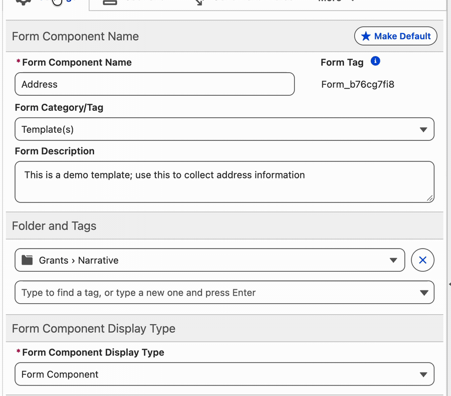
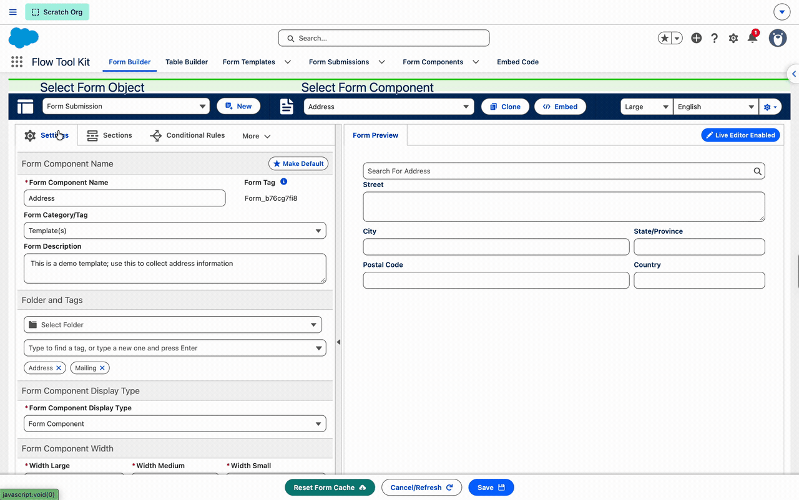
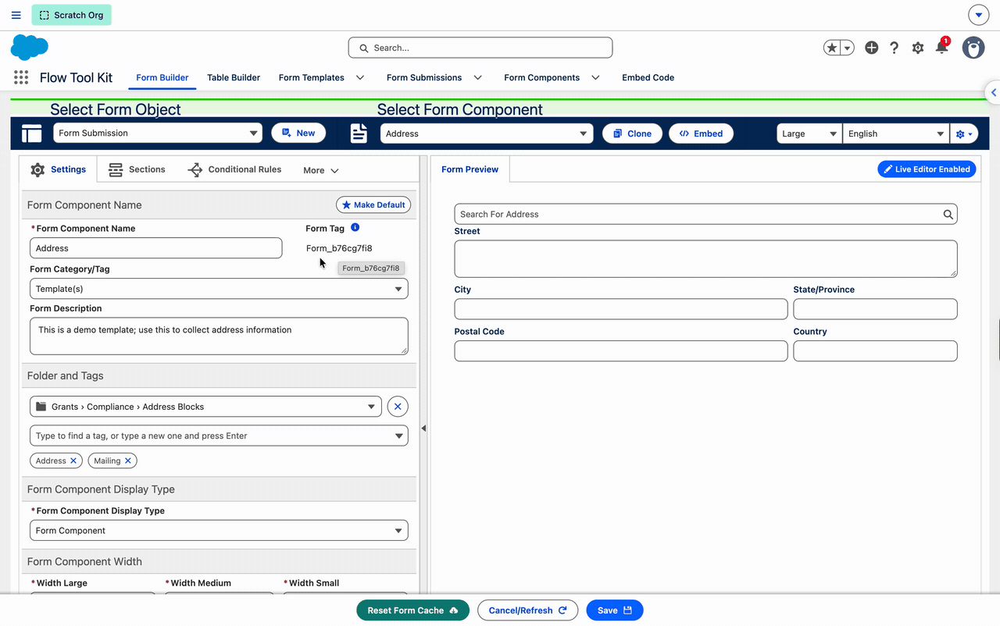

# Organize Form Components

Use folders, tags, and visual previews to find reusable forms in Form Builder. A folder gives a form one place in your library; tags describe uses it shares with forms in other folders.

## Add tags to a form

1. Open the form in **Form Builder** and select **Settings**.
2. Find **Folder and Tags**.
3. Select an existing tag, or type a new tag and press **Enter**. Repeat for additional tags.
4. Click **Save** to store the changes. To remove a tag, click the **×** on its pill and save again.

The example adds **Address** and **Mailing** to an address form.

## Create and select a folder

1. In **Settings → Folder and Tags**, click the folder selector.
2. Open the parent folder. Use the breadcrumb trail to move back up, or **Search folders** to find a folder by name.
3. To add a subfolder, click **New Folder**, enter its name, and click **Create**.
4. Click **Select Folder**, then **Save** in Form Builder.

The example creates **Address Blocks** under **Grants → Compliance**. A new folder remains available after a form is saved in it. The **×** beside the folder selector clears the form's folder assignment.

## Browse forms by folder

1. Click **Select Form Component** in the Form Builder toolbar.
2. Select a folder in the left-hand tree. A parent folder includes forms in its subfolders.
3. Review the form previews. Hover over a card, or focus it with the keyboard, to read its name, description, and tags.
4. Click the card to open that form in Form Builder.

Choose **All Forms** to browse the whole list, or **No Folder** to find forms without a folder assignment.

## Filter forms by tag

Open **Tags** in the form selector and select a tag, such as **Mailing** or **People**. The cards and folder counts update to match. When several tags are selected, a form can match any one of them.

Combine tags with **Category**, a folder, or the search box. Search matches form names and descriptions. Clear selected tags to broaden the results again.

## Related guides

- [Form Builder](../screen-components/form-builder.md)
- [Form Components System](../form-configuration/form-components-system.md)
- [Choosing an image for a section](../screen-components/form-builder.md#choose-an-image-for-a-section)
