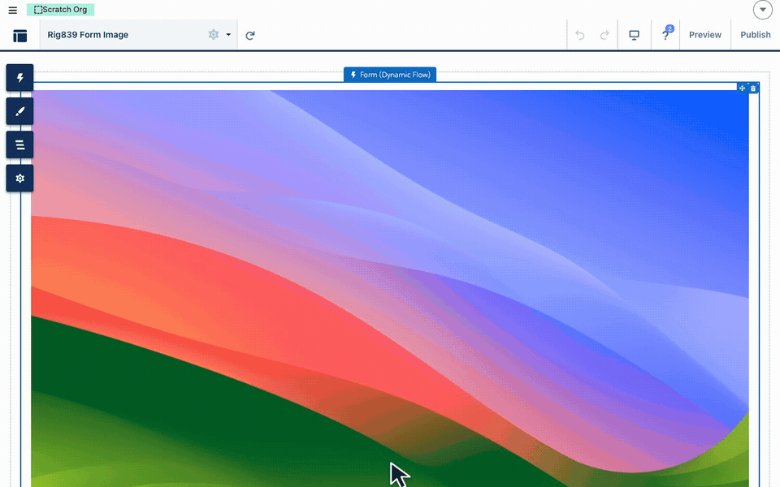

# Show Rich Text Field Images

> Use a photo stored in a rich text field as the image in Form (Image), a Record Card or a Design Block, including for signed-out site guests.


**Prerequisites**: Flow Tool Kit installed, an Experience Cloud site, and a **Rich Text Area** field on the object that holds the photos. Staff add a photo by pasting or uploading it into that field.


## How it works

A rich text field doesn't store the image itself. It stores a short link to it, about 160 characters per photo. Flow Tool Kit reads the link out of the field and draws the image from the address your site serves it at. The same field works on an Aura site, an LWR site and inside Salesforce.

| What you measure | Six records, six photo fields each |
|---|---|
| Data sent to the page | about 11 KB in total |
| Images downloaded | only the photos a card draws, loaded as each card scrolls into view |
| Time to draw all 36 photos for a guest | under 6 seconds (Aura) |

## Step 1: Give site guests access

Skip this step if only signed-in users will see the photos. A guest sees an image only when they can read both the record and the field.

1. **Sharing rule**: on the object, add a guest user sharing rule that shares the records with photos (for example, Account Name starts with "Public").
2. **Field access**: in a permission set assigned to the site's guest user, give **Read** on each photo field and on the object.
3. **Flow access** (Form (Image) only): add the flow to the same permission set, and open the flow's **Advanced** settings and select **Override default behavior and restrict access to enabled profiles or permission sets**. Without that setting, the guest sees "You do not have the level of access necessary".


A permission set deploy replaces the whole set. When you edit one by metadata, deploy the full file.


## Step 2: Choose where the photo shows

### Form (Image) in a flow

1. In the screen flow, add a **Get Records** element for the record.
2. Add **Form (Image)** to a screen.
3. Set **Custom Image Link** to the rich text field from the Get Records result (for example `{!Get_Account.Photo__c}`).
4. On a site, place the flow on a page with the **Flow Tool Kit** flow display component and pass it the **recordId**. A guest cannot open a `/flow/...` link directly on a site.

### A Record Card in a form

1. In Form Builder, add a **Record Card** section.
2. In the card's **Image** settings, set **Image Override Field** to the rich text field.
3. To show more photos on the card, add the other photo fields as rows. Each row shows its field's photo.

The same card works inside a **Dynamic Repeater**, so each record in a list shows its own photos.

### An Image section in a form

1. In Form Builder, add an **Image** section.
2. Set **Image Override Field** to the rich text field. The list offers Text, URL and Rich Text Area fields.
3. When the record's field holds a photo, the section shows it in place of the section's own image.

**Asset Name** shows a required marker, but the form saves without it. Leave it empty when every photo comes from the field, or pick an image to show when a record's field is empty.

This also works inside a **Dynamic Repeater**: each record's section shows that record's photo.

### A Design Block

1. In Experience Builder, add a **Record Card** or **Showcase** Design Block and give it the id of the record that holds the photo. The block needs the record to read the field.
2. Set the image source to **URL**.
3. In the URL box, type the rich text field's **API name** inside double curly braces, for example `{{Photo__c}}`. Type the field's name, not its contents: don't paste the photo or its link. The block reads the field from the record and draws whatever photo it holds, so each record shows its own.
4. The block's panel then shows **Image set** rather than the token. That is expected; the token is still saved.

## Step 3: Check as a guest

Open the page in a private browser window, signed out. If a photo is missing:

| What you see | Check |
|---|---|
| Nothing draws for one record | The record falls outside the guest sharing rule |
| No photos for any record | Field Read in the guest's permission set |
| "You do not have the level of access necessary" | The flow's restrict access setting in Step 1 |
| The page shows a login or 404 for the flow | Place the flow on a page; don't link to `/flow/...` |


From the release after 4.49:
* **Record Card rows that hold only a photo** show. Earlier versions treat a photo with no text as an empty row and hide it.
* **Rich Text Area fields appear in the Image section's Image Override Field list.** Earlier versions list only Text and URL fields.

Photos used as a Record Card's main image work in all versions.

