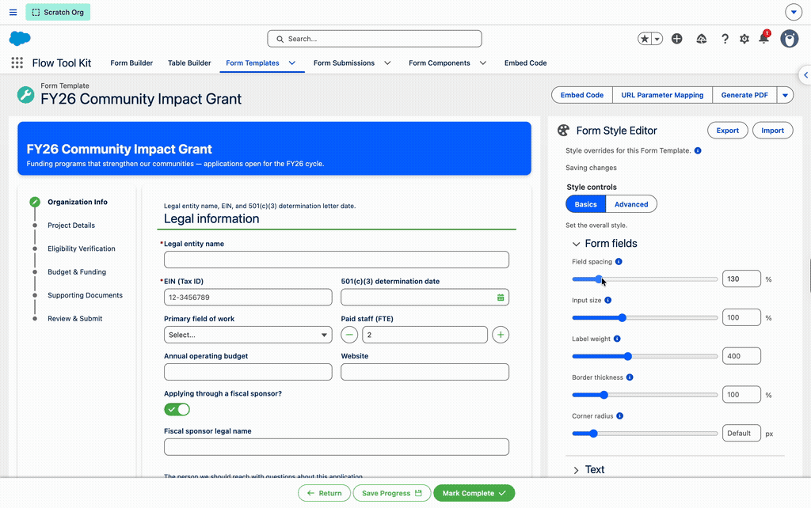
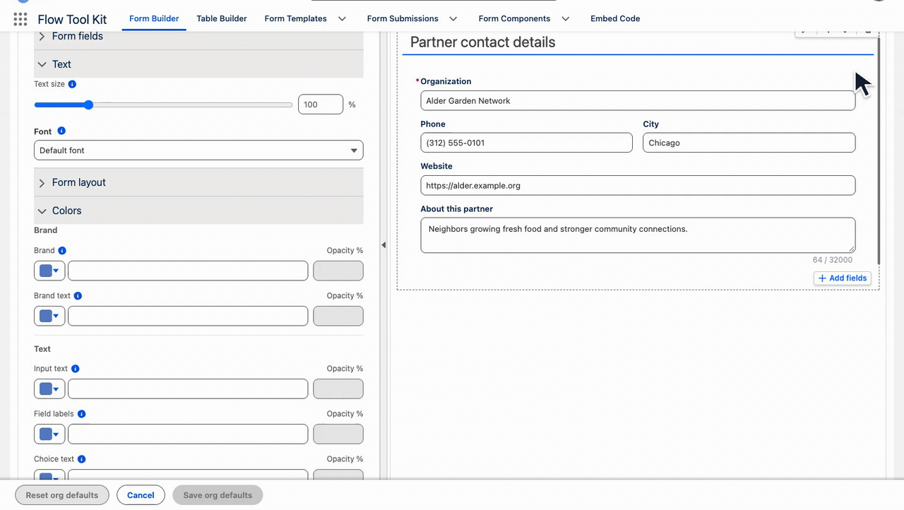
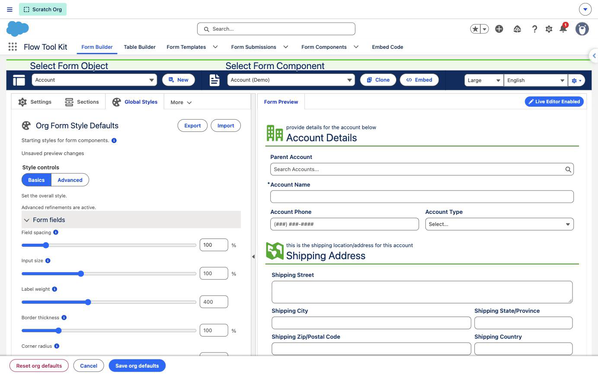
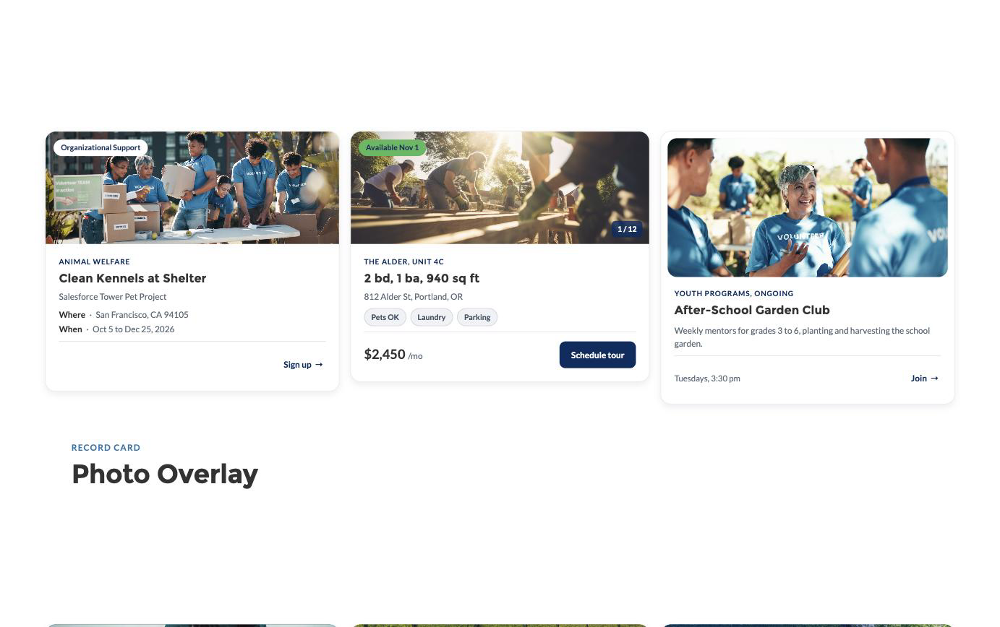
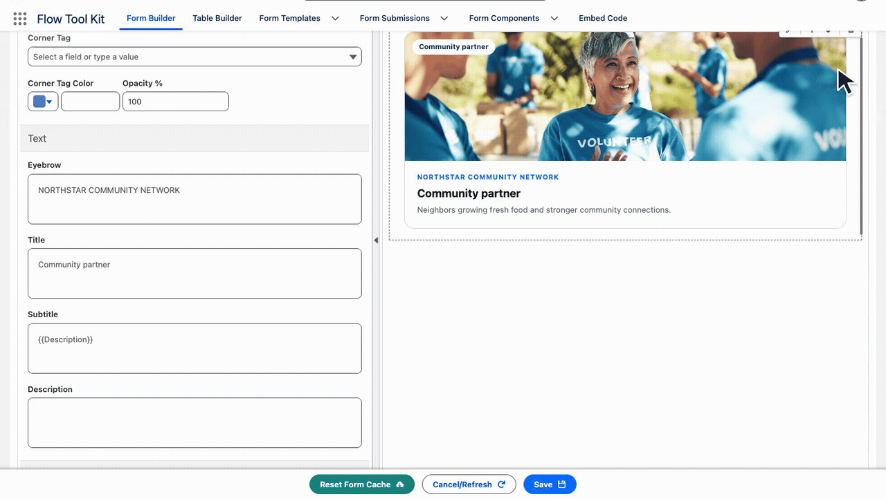

# Release 4.47

Release 4.47 ships Form Styles, the Record Card, and buttons that open a Flow or a Record Form in a window, plus fixes across sites, the Form Builder and the Flow runtime. Use the walkthroughs below to explore the new editors and cards, then review the compatibility and upgrade notes.

## 🆕 Style forms without writing CSS

Set org-wide defaults in **Form Builder → Global Styles**, then refine one template in its **Style Editor**. Preview changes as you work; export and import the settings to reuse them in another org.

*Make one template distinct while keeping shared org defaults for the rest.*

Global Styles requires **Save org defaults**. A template's Style Editor saves automatically after your last change. Clearing a template setting restores inheritance. [Follow the Form Styles quick start](../form-configuration/form-styles.md).

## 🆕 Make records easier to scan and act on

Record Cards turn record values into visual listings, event cards, profiles and progress summaries. Use the same card in Experience Cloud or as a Form Builder section. Card buttons can open a Flow or Record Form over the page.

*Put the important details and the next action together.*

*Build a partner spotlight using record fields. This walkthrough shows the editor preview.*

[Build a Record Card](../form-configuration/record-cards.md), choose from eleven card types, and connect buttons to the current record or a lookup. Countdown and Strip join the original nine types in this release. The broader theme-library work and Design Block object/field-list editor follow-ups remain separate work; this release does not claim those are complete.

## New settings and components

- Form Styles: Global Styles in Form Builder and a Style Editor on each Form Template, with export and import (#749)
- Record Card: a Design Block type and a Form Builder section type that lay one record out as a card (#781)
- Record Card Countdown and Strip types, due-date wording and a days-left tag (#814)
- Design Block and Record Card buttons open a Flow or a Record Form in a window over the page (#815)
- Form (Dynamic Component) on a site: a Theme Override picker (#826)
- Form (Dynamic Component): border colour, border width and background opacity (#828)
- Form (Dynamic Component) button: a button icon, spacing, and a Close on the window (#830)

## 🛠 Fixed and improved

- Form Styles introduces the token layer and theme-template groundwork; the broader six-theme offering remains separate work (#654)
- Design Block buttons retain their fill and text color on LWR sites. (#782)
- Pricing tier buttons receive their intended button styling on sites. (#783)
- Insert New Section options include a one-line description. (#784)
- Combo box lists stay aligned with their inputs when the surrounding panel scrolls. (#785)
- Form Builder previews show brand colors on selected controls. (#786)
- Checked checkboxes use a readable check mark on LWR sites. (#787)
- Site form themes apply their brand color to toggles and selected joined buttons. (#788)
- Experience Builder property previews load package styles and asset images without the reported page error. (#789)
- Record Cards load in Flow Builder debug without the GenerateUrl promise error. (#790)
- Experience Builder windows load the Style Editor layout and image-picker preview. (#791)
- Record Form Save buttons respect saved and themed brand colors. (#792)
- Validated Customer Community access requirements for Form Submission PDFs on sites. (#793)
- Repeated items support top and bottom margin and horizontal padding settings. (#794)
- Saved Form Builder changes reach subsequent Flow debug runs without the reported stale design. (#797)
- Related-field properties accept paths without an object-name prefix, including relationship paths. (#798)
- Form Template save and submit success messages support translation. (#799)
- Form Submissions without a Form Template stop loading and report the missing configuration. (#800)
- Record forms avoid showing an empty create form when the configured lookup is blank. (#802)
- LWR Support guidance explains placement on each directly loaded page or in the shared theme layout. (#803)
- Form Image editors avoid repeatedly emitting unchanged server URLs. (#804)
- Form, repeater and table metadata requests are deduplicated and protected against stale responses. (#805)
- Interval autosave stops when a Form Template component is removed. (#806)
- Grouped combo boxes handle empty options and refresh groups when options change. (#807)
- Detached components clean up UI timers and resize listeners. (#808)
- Source-template lookup, lead conversion and duplicate-bypass upsert actions support bulk execution. (#809)
- Multiselect checkboxes reuse selected-value sets while processing options. (#810)
- Table previews avoid rebuilding column state on every getter read. (#811)
- Floating dropdowns use the browser popover top layer to simplify positioning. (#812)
- Form loading reports an actionable API-name error when a label is supplied. (#813)
- Removed a stray character that prevented the lead-conversion invocable from compiling. (#817)
- Long Record Card titles preserve badge visibility at phone widths. (#818)
- Updated the style-alignment regression harness for its helper dependency. (#819)
- Record Form lookup buttons open the related record on Aura pages, even when the URL supplies a different recordId. (#820)
- Style validation rejects image-set() as well as url(). (#821)
- Unchanged Record Form saves resolve extension completion promises. (#822)
- Form Template access failures report the access problem instead of the tmpVar1 error, including cached loads. (#823)
- Flow Section selection handles deployed template links and shows empty-list and error messages. (#824)
- Inline JSON forms load their configured theme on sites. (#825)
- Unthemed form frames inherit host border and brand colors on sites. (#827)
- Design Block and Dynamic Repeater panels use consistent section headings and widths. (#829)
- Review pages omit empty review sections and their spacing, including Record Cards. (#831)

## Upgrading

Load each public form page once after installing, so the first compile happens before a visitor arrives. A Flow on an LWR page needs the FlowToolKit LWR Support component in the site footer or on the page.

## Guides and upgrade details

- [Form Styles](../form-configuration/form-styles.md): inheritance, saving, import/export and permissions.
- [Record Cards](../form-configuration/record-cards.md): card types, fields, images and actions.
- [Dynamic Component](../experience-cloud/experience-cloud-components.md): theme overrides and component styling.
- [LWR setup](../experience-cloud/lwr-site-component-support.md): place the support component where directly loaded pages can use it.

