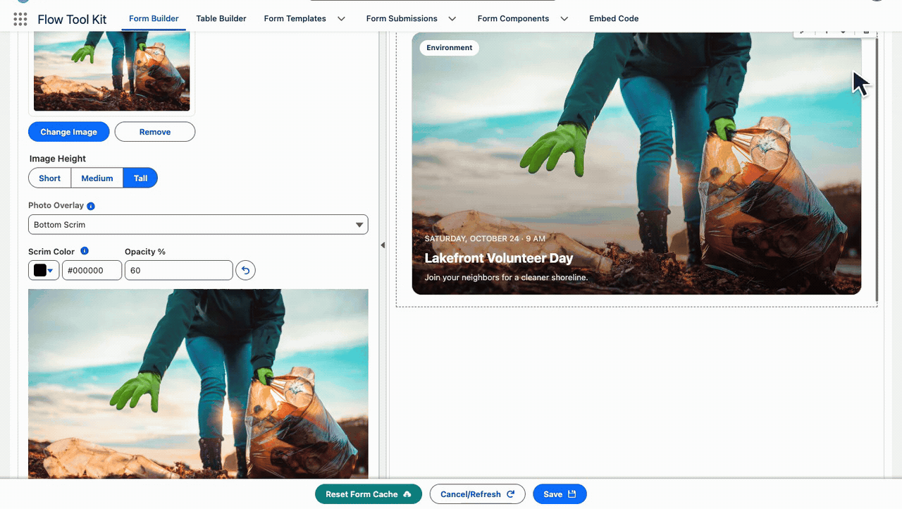
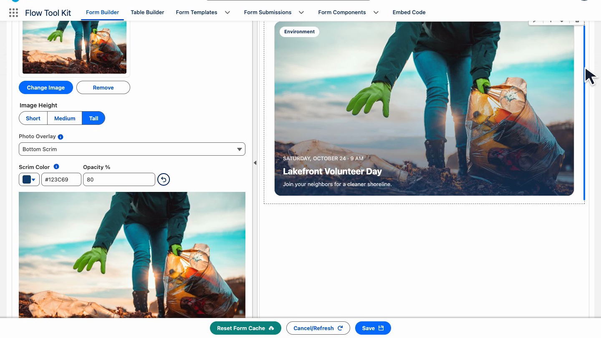
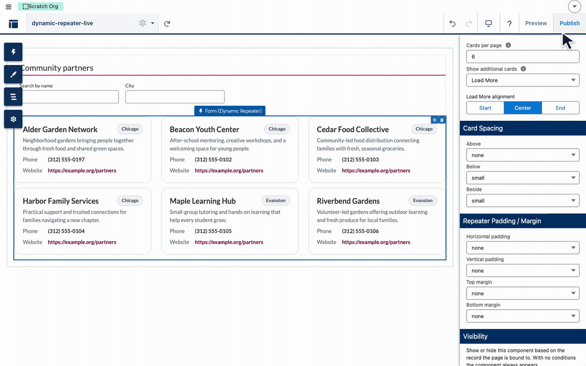

# Release 4.48

Release 4.48 is a small follow-up to 4.47: three additions and two fixes for the Record Card, the repeater and image inputs. After upgrading, load each public form page once so the first visitor does not wait on the one-time compile.

## 🆕 More control over cards, images and repeated records

Give Photo Overlay cards a scrim color that suits the image and keeps the text readable. Configure repeater spacing and display options through **FormRepeaterConfiguration**, and reuse Asset File references across the supported hosts.

*Keep the event title readable over photography. The walkthrough previews scrim changes; it does not save the form.*

### Give repeated cards room

*The component editor demonstrates the spacing controls introduced in 4.47. Release 4.48 also exposes these options through FormRepeaterConfiguration; this clip shows the visual editor, not that object configuration.*

### Configure the new options

| Goal | Setting or behavior | Guide |
| --- | --- | --- |
| Tint a Photo Overlay image | Scrim Color and opacity control its fades | [Record Card images](../form-configuration/record-cards.md#image) |
| Make the footer value stand out | Footer Right uses a filled chip and Corner Tag Color | [Record Cards](../form-configuration/record-cards.md) |
| Reuse an Asset File reference | Use an Asset API name, `asset:<name>`, `/file-asset-public/<name>` or a site file-asset path | [Image sources](../form-configuration/record-cards.md#image) |
| Configure a repeater programmatically | FormRepeaterConfiguration also accepts record spacing, sizes, Show Selected Only, Bottom Margin and Rich Text Variant | See the technical list below |

## Technical additions

- Record Card, Photo Overlay: a Scrim Color with opacity, so the side and bottom fades are no longer fixed to navy (#832)
- Form (Repeater): record spacing, the three sizes, Show Selected Only, Bottom Margin and Rich Text Variant can be set through the FormRepeaterConfiguration object as well as on the component (#835)
- Image inputs: an Asset File written as /file-asset-public/<name>, a bare Asset API name, asset:<name> or a site file-asset path loads on a Record Card, a Design Block and Form (Image), on Lightning pages, Flows, the embed page and sites (#837)

## Fixed and improved

- Form (Repeater): the pagination and carousel playback row no longer hangs past the records' edges (#833)
- Record Card, Photo Overlay: Footer Right is drawn as a filled chip, like the corner tag, and takes the Corner Tag Color (#834)

## After upgrading

Load each public form page once before visitors arrive. Existing Record Cards and repeaters retain their configuration; review Photo Overlay scrim and footer colors where you want to use the new controls.

