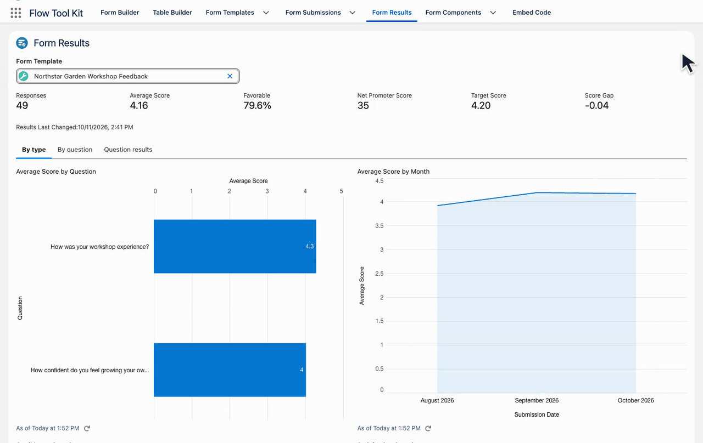
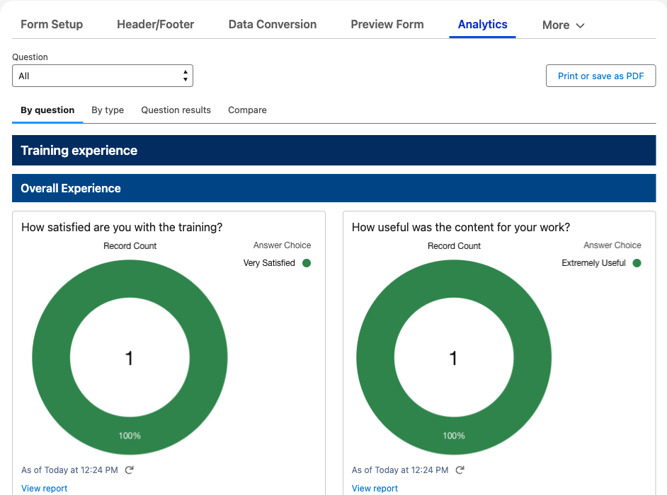
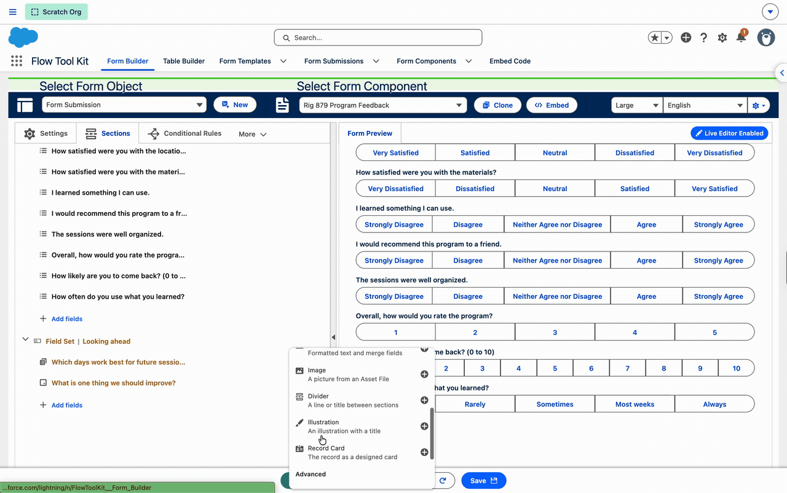
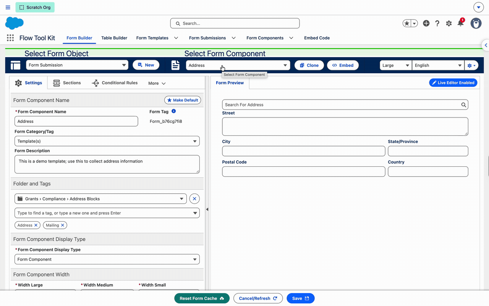
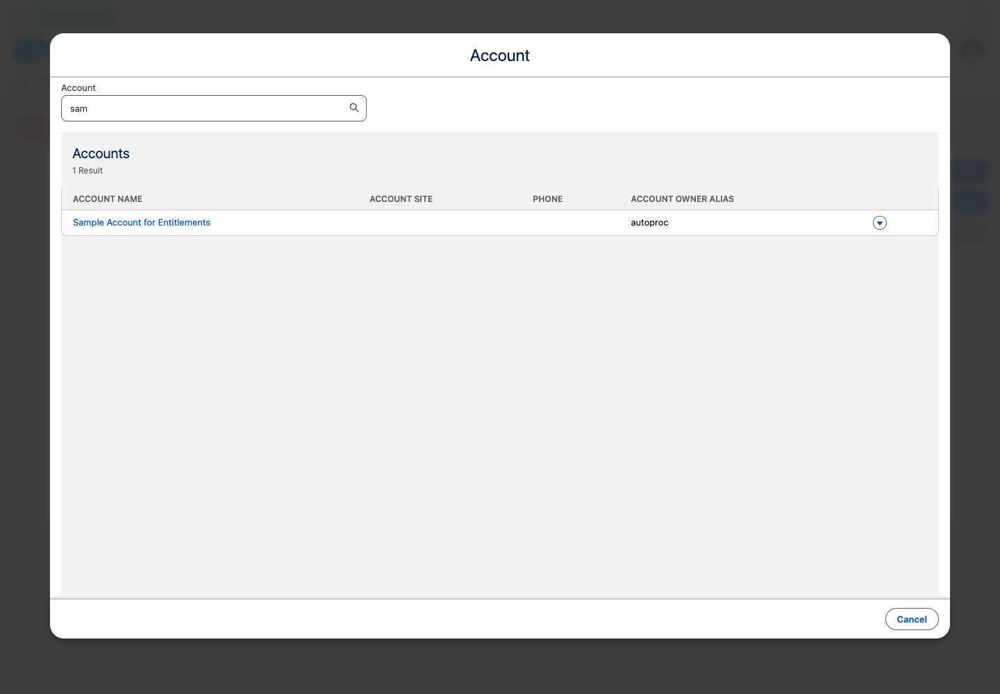

# Release 4.49

Give respondents a focused survey experience, turn their answers into useful charts, and build richer pages with visual selectors. Release 4.49 brings Survey Mode and Form Analytics together with improvements for phone layouts and everyday form interactions.

## 🆕 Survey mode and Form Analytics

### Keep attention on the question

Survey Mode brings the active question forward while keeping the rest of the form available. Respondents move through choice questions with a click, while text and multi-select answers use **Next**. Enable it per section, so a form can combine focused survey questions with its existing layout.

*From a training evaluation to a feedback survey, give each question room to be read and answered.* [See the Survey Mode guide](../form-template-framework/survey-mode.md).

### Turn feedback into a useful picture

Enable Form Analytics to collect reporting answers, compare response distributions, and explore results by question, question type, or campaign. Stored metrics help administrators review response counts, scores and trends.

*Explore the overview, then look at individual questions to understand the responses behind the numbers.*

*Open Analytics directly on the template to review answer charts.* [Learn how reporting and recalculation work](../form-template-framework/survey-results.md).

### Technical details

- Survey mode is set per section (Survey Section on a page section) and frames each question as a card; the progress indicator lines up with the fields (#889, #885)
- Form Analytics: one Enable Form Analytics switch on the template writes a Form Submission Answer per question and answer, with campaign, score and choice order, so surveys can be reported on; a results page with charts by question type, by question and by campaign; stored Form Template Results with the headline numbers (#879, #890, #883)
- Analytics reports ship in the Form Template (Analytics) folder; the Create Form Submission Answers action names the fields that never become answers and takes a Skip Fields list
- A fourth permission set, Form (Builder Internal User), for internal users who work with form data, and a description on every permission set (#881)
- The Form Template preview shows External Only pages, an opened submission stays at the top, and the page record page previews Custom mode sections (#891, #884)
- Survey mode and results media and the refreshed guides (#880)

## 🆕 Design Blocks

### Find the right image visually

Search the image library, browse folders, and choose from tiles in the rebuilt **Select Image** window. The recording shows the selected image returning to the form editor.

*Choose imagery with a visual preview instead of relying on an asset name.*

### Layout and editing improvements

- Phones: an explicit heading or body alignment is kept in a narrow container, bullets stack their title and description, entrances play once and a tall block enters, the timeline no longer scrolls the page sideways, hero highlights no longer break inside a word, stats bar values and labels are readable, cards' Split arrangement no longer squeezes (#840, #841, #847, #848, #849, #850, #858, #860)
- Colors: a dark section's Accent Color now drives what the Brand Color drives on a light one; photo scrims default to the brand color unless a Scrim Color is chosen; a Check Color for a checklist's tick (#852, #838, #864)
- Hero: one explicit choice of what sits beside the copy (Image, Facts, Timeline, Bullets, None) and where; Facts, Milestones and Bullets are edited inside Media; Button Alignment works across the top; Column Ratio is right when the Media Side is Left; a spacing control for each part; Showcase is folded into Hero (#857, #863, #861, #862, #870, #865, #855)
- Editor: a clone button on every repeatable item; a list's settings stay hidden until its first item; Marker colors are no longer offered where they do nothing; Space Below Heading and Footnote Alignment apply everywhere; vertical milestones get their room; a callout's Supporting Points move to Cards (#856, #867, #853, #854, #859, #868, #866)
- An Image Gallery type (mosaic, grid, masonry, filmstrip) with an All photos window and a photo viewer; the Image type keeps its settings under Heading (#871, #872)
- The Select Image window: search, folders and tiles, on the same Apex (#873)

## 🛠 Forms and templates

### Preview a form component before choosing it

The component selector shows live previews, with folders and tags to narrow the choices.

*Find a reusable component and see its fields before adding it to your form.*

### Keep dialogs above the form

A lookup search opened from a flow sheet now appears above it, so users can read the results and return to their form. Full-size sheets use a large layout on desktop and fill the phone width.

*The Account search stays in front of the form that opened it.* [See modal sizing and behavior](../experience-cloud/dynamic-flow-display.md#how-it-works).

### Fixes and behavior changes

- Record Form: a user with Read only on the record gets a read-only form on record pages and site pages, with no upload and no Save; Flow screens stay editable (#893)
- Form (Dynamic Flow): the full-size sheet opens on the package's own dialog, so a lookup's search window, a confirm or another package's dialog opened inside it is drawn above it, on sites and in Lightning; Modal Size full is edge to edge on a phone (#894)
- File upload: on a site under a path prefix a saved file's link stays on the site and serves the file through it, a PDF opening in a new tab and other types downloading; in Lightning it still opens the preview (#895)
- Every explicit logged-in save of a Form Template runs the upsert flow, so a client's override of the flow applies to internal and site users too; Lightning Data Service is the fallback when the flow is unreachable; autosave stays on Lightning Data Service and Flow screens keep their own save logic (#896)
- A save refused by Lightning Data Service shows one sticky error toast on every host, LWR sites included (#892)
- Styles set on a template are applied again; a chosen theme wins (#878)
- A lookup shown as a Form Component stays inside its field and the Form Builder shows its form selector (#877, #876)
- Form (Dynamic Flow) Button display type: Top Margin and Bottom Margin (#897)
- Review page: section headers, and a page that only holds text is skipped (#886)
- Form Component selector: a window of live quarter-size previews (#874)

## Considerations

- Load each public form page once after upgrading; the first request compiles the components.
- On a site, a saved file's link now serves the file through the site (a PDF opens in a new tab, other types download) instead of opening the preview viewer.

## 📘 Guides and walkthroughs

- [Survey Mode](../form-template-framework/survey-mode.md): section settings and recorded respondent walkthroughs.
- [Survey Results](../form-template-framework/survey-results.md) and [Question Reporting](../form-configuration/question-reporting.md): analytics, answer inclusion and recalculation.
- [Dynamic Flow Display](../experience-cloud/dynamic-flow-display.md#how-it-works): full-size sheets and dialogs opened inside them.
- [File Uploads](../form-configuration/file-uploads.md#open-a-saved-file): saved-file links on sites and in Lightning.
