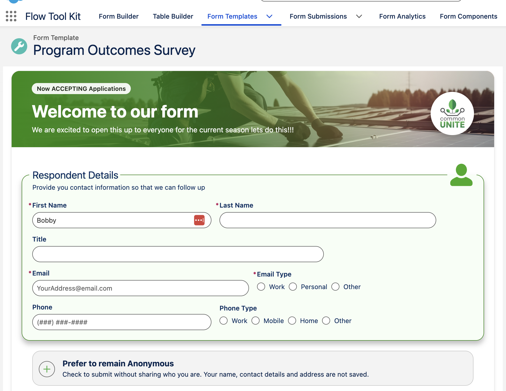
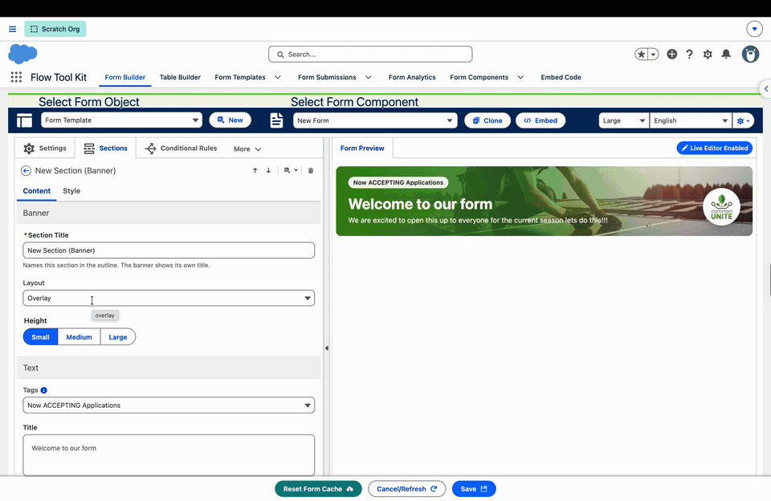
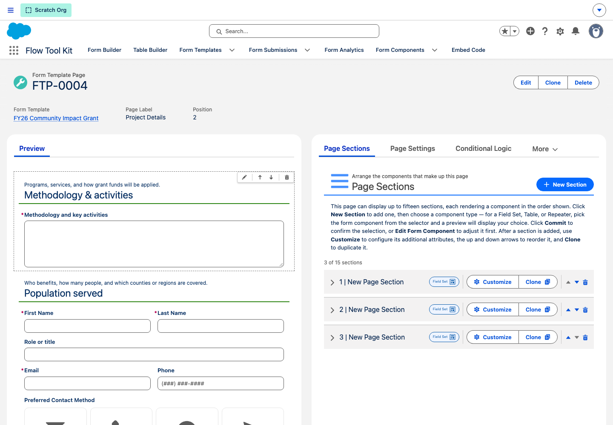
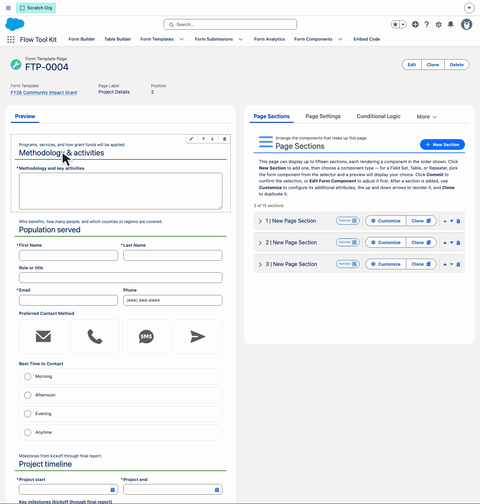
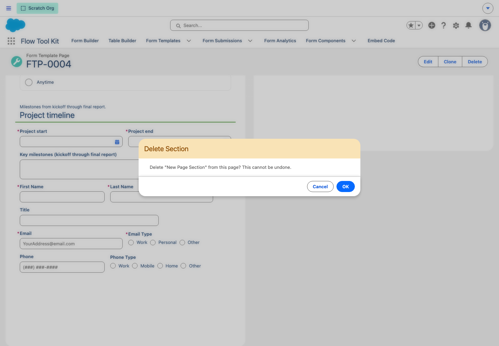
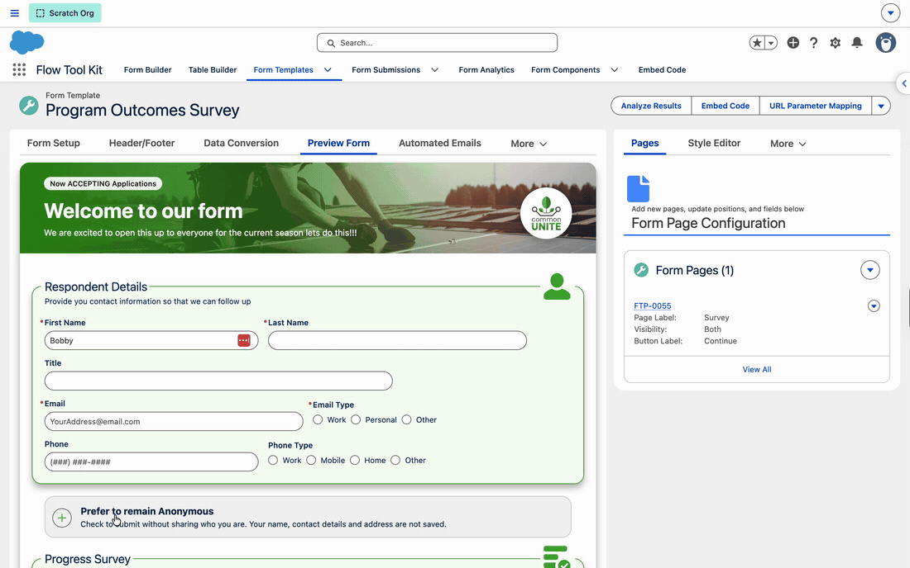
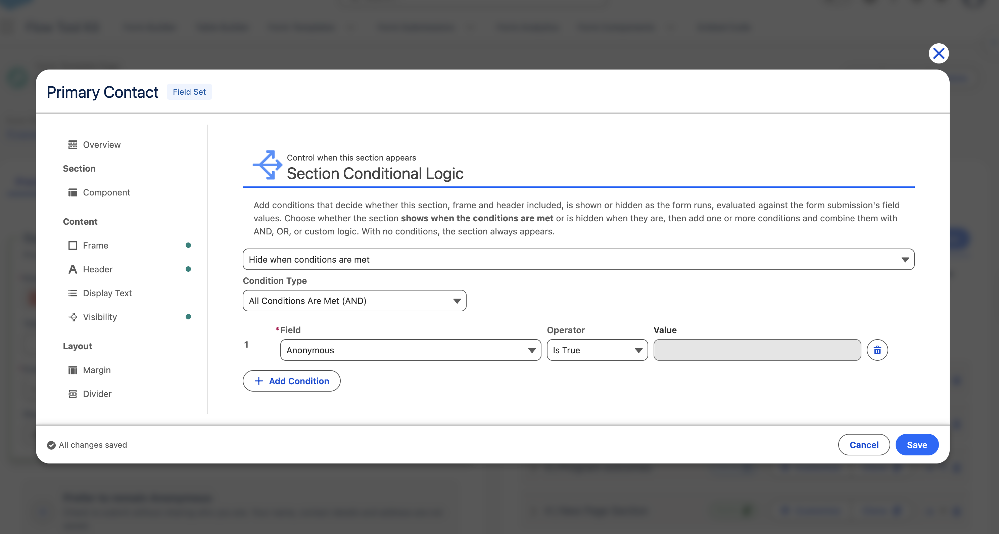
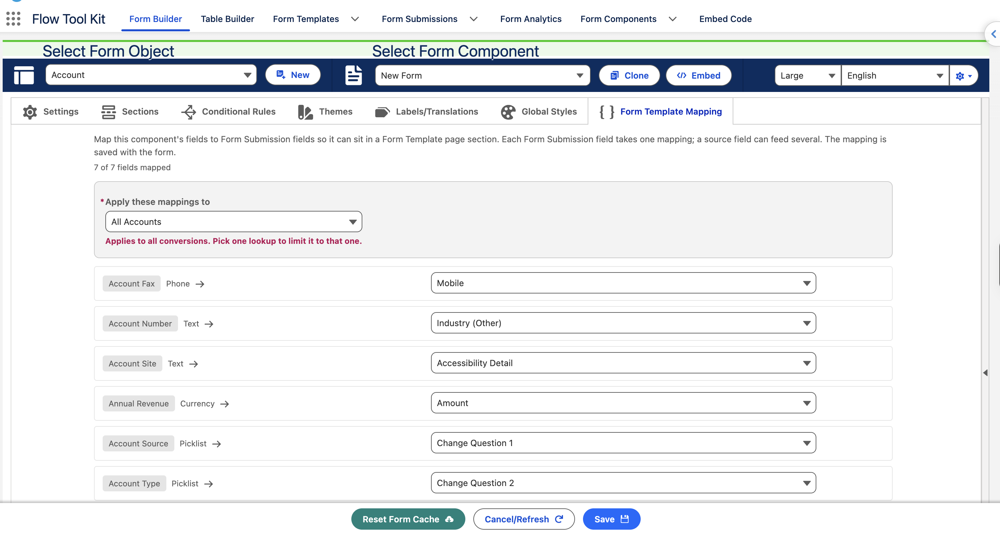

# Next Release (Unreleased)

Draft notes for the release that closes the `sprint/2026-10-14-mobile-review` sprint. Entries are added as features complete; the page is renamed to its release number when the version ships.

## 🆕 Form Templates

### Banner sections

A new **Banner** section type gives any form a branded title: a photo, your logo, a title, a subtitle and tags. Add it from **Add Section** in the Form Builder, or put it in a Form Template header so the form opens with your brand.

*A branded form title without writing HTML or borrowing a Record Card.*

- **Three layouts:** Overlay, Split and Compact. Compact suits single-page forms; Overlay at Small suits multi-page forms with the vertical page indicator.
- **Small, Medium or Large.** Small follows its text.
- **Background image** from your images, or from a field on the record.
- **Scrim, tag and background colors**, and a logo on a Square, Circle or no card.
- **Rich text title and subtitle** with merge fields, and tags from semicolons or a multi-select field.
- **Padding** settings add space inside the banner.

In a single-card Form Template, the header banner's bottom corners are square so it joins the form. [Read the guide](../form-configuration/banner-sections.md).

### Edit a section from the page preview

On a Form Template Page, hover a section in the **Preview** and a dashed box appears around it with a small toolbar in its top right corner, the same box the Form Builder shows. Edit, move and delete happen where you are looking, and the **Page Sections** list beside the preview follows every change.

*Work on the section you can see instead of finding its row in the list.*

- **Edit Section** opens the section's editor. A spinner covers the section until the editor is up.
- **Move Section Up** and **Move Section Down** swap the section with its neighbour. The preview and the list reorder together, and the arrows that would move a section off either end are disabled.
- **Delete Section** asks for confirmation on the page first. Cancel leaves the section untouched.

Hover works on whole sections, never on single fields. Clone stays in the Page Sections list, and edits made in the list still update the preview. [Read the guide](../form-template-framework/pages-and-sections.md#editing-sections-from-the-preview).

### Show or hide a section with conditions

Page sections now take conditional logic, the same rule editor pages use. Set it from **Customize > Visibility** or the section's new **Conditional Logic** tab. The section hides or shows the moment a field on the same page changes.

*Ask only what applies, without splitting a page into extra pages.*

- **The whole section hides,** frame and header included.
- **Hidden fields save blank** and skip validation, review, the PDF and Answers. Unhide in the same visit and the answers come back.
- **Tables and repeaters** in a hidden section hold their rows; nothing in them saves while hidden.
- **A page with every section hidden** is skipped like a hidden page.

[Read the guide](../form-template-framework/pages-and-sections.md#section-conditional-logic).

### Use an Account or Contact form in a Form Template

A Form Template page section can now hold a form on another object, such as Account, Contact or a custom object. Map its fields to Form Submission fields once on the new **Form Template Mapping** tab in the Form Builder, and the form reads and writes the submission instead of its own object.

*Reuse the forms you already built instead of rebuilding them on Form Submission.*

- **Form Template Mapping tab:** each field on the form gets a Form Submission field picker. Only fields whose type lines up are offered, so a bad mapping cannot be picked.
- **Apply these mappings to:** All of the object, or one Form Submission lookup when a submission converts to two records of the same object.
- **Page section picker:** switch objects in **Select Form Component**; forms with a map show a **Mapped** pill.
- **Live in step:** a mapped section shows prefilled values, and a change to the same field in any other section shows up in it. Repeaters, tables and the PDF work too.
- **Never writes its own object:** the form saves only the Form Submission.
- **Conversion fills it in:** the new **Apply Submission Field Maps** action fills fields the Transform left empty. It is already in the Account, Contact, Lead, Case and Opportunity conversion flows. A mapping that cannot be written is skipped and logged, and the conversion carries on.

If you have overridden one of those conversion flows, add the action to your copy. [Read the guide](../form-template-framework/form-template-mapping.md).

## 📱 Forms on phones

A guest mobile audit covered every form component, Design Block and Form Template layout at 390, 430 and 1300 px (#915, guest mobile UX audit). The findings below are fixed; nothing changes on a desktop unless the line says so.

### Forms and fields

- Vertical form tabs draw across the top on a phone, so the answers get the full width instead of 75 px (#922)
- A collapsed repeater row on a phone shows Add, Duplicate and Remove as icon buttons with the label as the tooltip, so the actions no longer run off the screen (#923)
- The Header component with several actions puts them on a row of their own under the title on a narrow screen, instead of squeezing the title to one character per line (#919)
- A long section heading wraps beside its divider rule instead of running past the phone frame, in every divider style (#941)
- A date or time input at a larger control scale stays inside its field (#925)
- Before and After text stays beside the input when an error or help line appears under it (#930)
- A date field with a minimum or maximum now says the date is too early or too late on a phone, not that the number is too low or high (#931)
- The Image upload preview shows the whole picture scaled to the card instead of a cropped 16:9 window, on phones and on desktop (#934)
- The docked button bar keeps the page's last field above it, so a spaced dock no longer covers the final textarea (#917)
- A full-size Dynamic Flow dialog always carries a Close in its pinned footer, since the header's X sits above a phone screen (#943)
- Path-style choices wider than a phone scroll sideways, so every choice can be reached instead of the later ones being cut off; desktop paths look the same (#945)
- On a narrow form the accordion section's action (such as a confirm checkbox) sits at the top of the section body instead of over the section title; it shows while the section is open. Wider forms keep it in the header (#948)
- Button Line Height and Button Side Padding on the Flow buttons are now labelled in rem. A value above 6 rem, usually a pixel number typed by mistake, is ignored, so the docked buttons no longer stretch to fill the screen (#944)
- Read-only inputs take the read-only corner radius token; their border stays the platform's disabled border (#928)
- Theme background position and size now apply to the form and the heading, not only to sections (#942)
- Carousel Back, Next and Finish labels set in the Form Builder are used; the typed picklist defaults no longer cover them (#929)

### Form Templates

- Stages mode on a phone: every stage row expands on tap and shows its Continue button, so a vertical stage list can be entered (#921)
- A page section whose header sits in the frame no longer draws its Header Text a second time inside the repeater, in the preview and at runtime (#952)
- Edit Modal Return On Select on a page section is marked deprecated with help text; it never had anything to act on (#936)

### Form Builder

- The Add fields strip stays open while any field in the section is hovered and doubles as the section's handle, so a section with a hidden title is easy to grab (#953)

### Design Blocks

- A Record Form button on the page's record is drawn even when the block reads nothing else from the record (#926)
- Table cards on a phone label every value, including the last column (#938)
- A long Stats Bar value wraps inside its stat instead of running past the bar (#918)
- Stat labels and values never go below 12 px, so compact presets stay readable (#939)
- The timeline demo's item titles are readable on a dark section (#937)
- The photo viewer opened from All photos is reachable by assistive technology: All photos closes first and returns when the viewer closes (#940)
- The carousel's slide selector keeps its thin bar but gets a 44 px touch target (#916)
- The form window opened from a Design Block button keeps its close X on screen on a desktop; the form scrolls inside the window so the whole window fits (#950)

## 🛠 Fixes and behavior changes

- Form Template Page: a hover toolbar on every section of the preview, with edit, move up, move down and delete; the two components talk over a message channel so each preview slot keeps operating on its own (#956)
- LWR Experience Builder no longer reports "ResizeObserver loop completed with undelivered notifications" when a form, a Design Block or a Form Template is on the page. Every size observer in the package now applies its layout change on the next frame through one shared helper, and a test fails the build if a new observer bypasses it. Pages that fired the error on every width change (image gallery, horizontal timeline, Likert matrix, responsive choice) were measured clean afterwards; nothing visible changes (#957)
- An answer typed while an autosave is still running is kept. Before, the saved record coming back from the upsert flow replaced the newer answer on screen and in the next save (#951)
- Deleting an uploaded file without uploading a replacement now removes the file. Before, a delete on its own left the File Upload field marked as already processed, so conversion skipped it and the file stayed in Salesforce; deleting and replacing worked only because the new upload reset the mark. Templates with Conversion Type Bypass still never run the file step (#969)
- A Form Template's per-page field list (what conditional logic blanks when it hides a page, and the field inventory on the template page) is now built from the form's design, not from the field access of whoever loads the template first. Before, a site guest who could not read one field removed it from that list for every later user until the form cache was reset, so a hidden page could keep that field's answer (#970)
