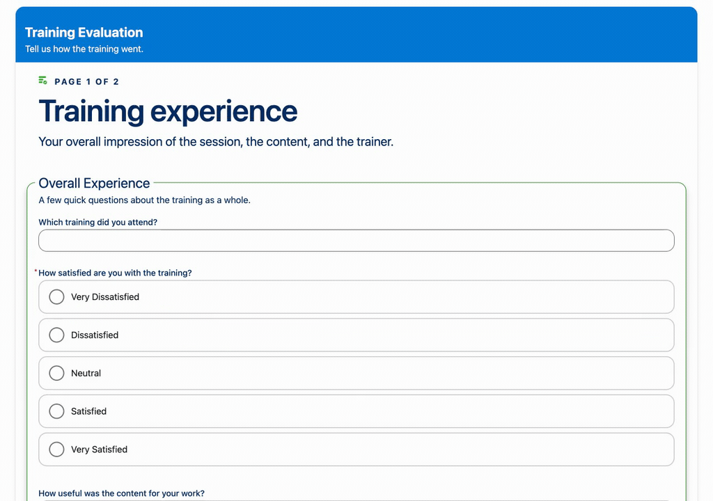
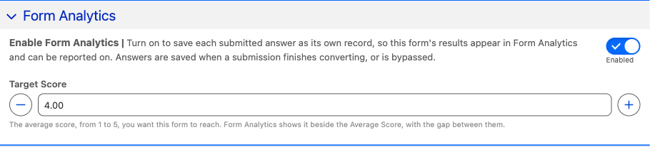
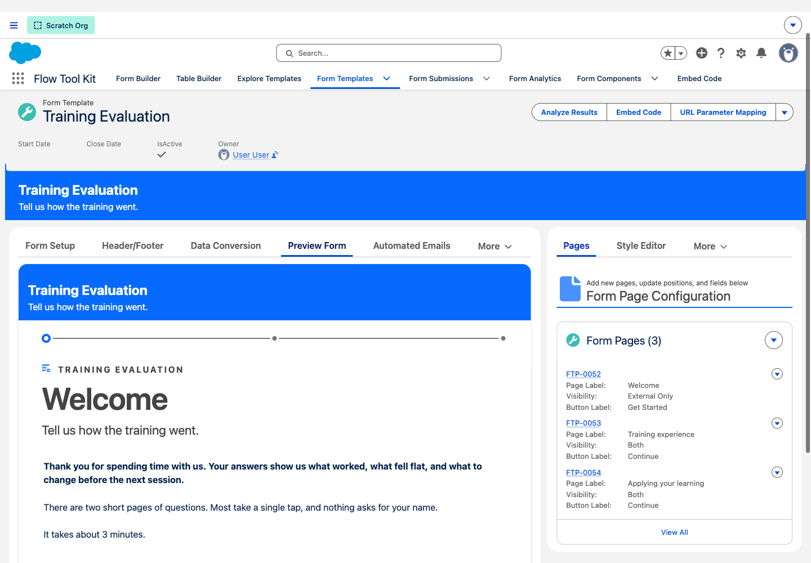

# Survey Mode and Form Analytics in Release 4.49

These features shipped in [Release 4.49](release-4.49.md). This walkthrough retains the recorded survey and analytics examples.

## Focus on one question at a time

Enable **Survey Section** in each page section's editor, beside **Do Not Print**. The same control is available in **Customize → Component**. It replaces the former template-level Survey Mode switch.

A page opens without question cards or an overlay. Entering a question brings up its card and a 95 percent white veil; clicking the veil returns to the ordinary page layout. Single-choice answers advance with one click. Text and multi-select questions use **Next**, while the form's footer remains available.

When moving between survey sections, the next section appears as a whole. Single-question sections, including matrices, keep their heading and content together. See [Survey Mode](../form-template-framework/survey-mode.md) for the settings, keyboard walkthrough, mobile matrix, and Aura example.

## Enable Form Analytics

Turn on **Form Template Settings → Form Analytics → Enable Form Analytics** to create reporting answers when submission conversion is **Complete** or **Bypassed**. This replaces the former Submission Answers rule and Survey conversion type. Custom mode sections can contribute answers. Turning on survey presentation does not enable analytics automatically.

The template's **Analytics** tab appears when the switch is on. **By question** shows answer charts, and **View report** opens the report filtered to that template and question. Stored question metrics still use the separate **Recalculate Results** job.

See [Survey Results](../form-template-framework/survey-results.md) and [Question Reporting](../form-configuration/question-reporting.md) for the reporting workflow.

## Preview and review forms

**Preview Form** includes pages marked **External Only**. Reopening a submitted response keeps the page at the top. Page-record previews show Custom mode sections, and a configured review page displays read-only review boxes with Edit buttons.

